# AWS Deployment Guide: Pit Stop Platform (v3.0 Production Platform)

**Target Environment:** AWS Asia Pacific (Sydney) - `ap-southeast-2`  
**Stack Architecture:** Next.js 15 App Router (AWS Amplify Hosting) + Amazon DynamoDB (Single-Table Design via Terraform)  
**DevOps & Security:** S3 Remote Backend with Native Lockfiles, GitHub Actions Keyless OIDC Federation, CloudWatch Free-Tier Dashboard  
**Cost Profile:** 100% Scale-to-Zero ($0.00 Idle Infrastructure Cost)  
**Security Posture:** Zero Hardcoded Secrets, Least-Privilege IAM Policies, Zero Team Resource Coupling, Strict Zero-Secret Public Tracking  

---

## 1. Architecture & Cost Analysis

The Pit Stop Food & Merch Drop platform is architectured for high-throughput, low-latency grandstand fan ordering during the Australian Grand Prix at Albert Park.

```mermaid
flowchart TD
    subgraph ClientTerminal["Client Devices & Concession Terminals"]
        FanClient["Fan Mobile Web / PWA\n(Safari / Chrome - Group Orders, Live Tracker /track/[orderId], History)"]
        VendorKiosk["Vendor Kiosk Staff Terminal\n(/vendor - Staff PIN, 8-Bay Lockers, Race Control)"]
        OfflineSyncOutbox["Offline Fulfillment Outbox (syncQueue.ts)\n(Airplane Mode Simulator + Auto-Sync)"]
        OfflineVerifier["Isomorphic Ed25519 Verifier (@noble/curves)"]
        
        VendorKiosk --> OfflineVerifier
        VendorKiosk --> OfflineSyncOutbox
    end

    subgraph AWSCloud["AWS Region: ap-southeast-2 (Sydney)"]
        AmplifyEdge["AWS Amplify Hosting (CloudFront CDN)"]
        
        subgraph ServerlessSSR["Next.js 15 Serverless SSR Engine"]
            APIInventory["GET /api/inventory & POST /api/inventory/restock"]
            APICircuit["GET & PATCH /api/circuit/status (Live Flags: Green, Safety Car, Red, Post-Race)"]
            APIStations["GET /api/stations/capacity & GET /api/stations/lockers (#01..#08)"]
            APIOrders["POST /api/orders (Zod Schema, Token Rate Limiter, TransactWriteItems)"]
            APIHistory["GET /api/orders/history (GSI1 Fan Queries)"]
            APITrack["GET /api/orders/[id]/public (Zero-Secret Read-Only Tracking)"]
            APICheckout["POST /api/payment/checkout (Idempotent Payment)"]
            APIStatus["PATCH /api/orders/[id]/status (Staff PIN Guard)"]
            APIRewards["GET & POST /api/rewards"]
            APICrypto["GET /api/crypto/public-key (SPKI Ed25519)"]
            PassSigner["Server Ed25519 Pass Signer (crypto.sign)"]
        end

        subgraph StorageLayer["Amazon DynamoDB (pitstop_data)"]
            Table[("Single-Table Design (PAY_PER_REQUEST)")]
            ItemRecords["ITEM#<id> (stock, isLimitedDrop)"]
            OrderRecords["ORDER#<id> (7-Day TTL, Express Bay #01..#08)"]
            CircuitRecord["CIRCUIT#STATUS (Live Dynamic Flag State)"]
            GSI1Index["GSI1: Ticket Code Lookup (TICKET#<ticketCode>)"]
            GSI2Index["GSI2: Concession Pod & PIN Queries (PIN#<pinCode>)"]
            TTLPolicy["TTL: 7-Day Auto-Expiration (ttl)"]
        end

        subgraph DevOpsInfra["IaC, CI/CD & Observability"]
            S3Backend["S3 Remote State Bucket\n(pitstop-tfstate-608531435714-ap-southeast-2\nuse_lockfile = true)"]
            OIDCRole["GitHub Actions Keyless OIDC Role\n(pitstop-github-actions-terraform-role)"]
            CWDashboard["CloudWatch Dashboard\n(pitstop-production-dashboard)"]
            CWAlarm["SystemErrors Metric Alarm\n(pitstop-dynamodb-system-errors)"]
            BudgetAlert["AWS Budgets ($5.00/mo Limit with 80% Alert)"]
        end
    end

    FanClient --> AmplifyEdge
    AmplifyEdge --> ServerlessSSR
    APIOrders --> PassSigner
    APIOrders -->|"Atomic TransactWriteItems\n(ConditionCheckItem stock >= qty)"| Table
    APIHistory --> Table
    APITrack --> Table
    APICircuit --> Table
    APIStations --> Table
    APICheckout --> Table
    APIStatus --> Table
    APIRewards --> Table
    Table --- GSI1Index
    Table --- GSI2Index
    Table --- TTLPolicy
    VendorKiosk -.->|"Offline Airplane Mode Scans (< 10ms SLA)"| FanClient
    OfflineSyncOutbox -.->|"Auto-Flush on Reconnection"| APIStatus
```



### Scale-to-Zero ($0.00 Idle Cost) Verification
1. **DynamoDB On-Demand (`PAY_PER_REQUEST`)**:
   - The table `pitstop_data` and Global Secondary Indexes `GSI1` and `GSI2` are configured with `billing_mode = "PAY_PER_REQUEST"`.
   - **Zero Provisioned Capacity Units (`RCU = 0, WCU = 0`)**: No hourly reservation charges are incurred.
   - When no fans or vendors are querying the database (e.g. between race weekends), read and write costs are exactly **$0.00**.
   - **Storage Free Tier**: AWS provides 25 GB of permanent free DynamoDB storage under the AWS Free Tier, easily containing all product catalogs, race drop points, fan profiles, and orders.
2. **Atomic Inventory Decrements with Condition Checks**:
   - Limited drop merch orders execute via `TransactWriteItems`, evaluating `stock >= :qty` across all ordered SKUs alongside the `PutItem` for the order.
   - Ensures zero overselling or ghost stock with zero distributed locks or third-party cache clusters.
3. **Automated Order Auto-Pruning (TTL)**:
   - Order records automatically carry a 7-day TTL epoch timestamp (`ttl` attribute).
   - DynamoDB purges expired order items in the background at zero consumed write capacity cost.
4. **Amplify Hosting SSR Compute**:
   - SSR API routes execute as ephemeral serverless compute.
   - When no HTTP traffic reaches the endpoints, compute scales to zero instances.
5. **Terraform S3 Remote Backend with Native Lockfiles**:
   - State stored in S3 bucket `pitstop-tfstate-608531435714-ap-southeast-2` with `use_lockfile = true` (Terraform 1.10+ native S3 locking).
   - Eliminates the need for a dedicated DynamoDB state locking table, saving extra read/write operations and infrastructure complexity.
6. **AWS Budget Guardrail**:
   - Infrastructure includes an automated budget alarm (`pitstop-monthly-budget`) configured for $5.00/month with an 80% threshold notification.
7. **Offline Fallback Resilience**:
   - When offline or when AWS credentials are intentionally withheld, the platform operates in local in-memory/browser storage mode with full circuit map fallback (Albert Park SVG fallback).

---

## 2. Security & Compliance Verification

| Security Domain | Status | Audit Findings |
|---|---|---|
| **Hardcoded Secrets** | **VERIFIED CLEAN** | Zero AWS keys (`AKIA...`), zero private keys, and zero tokens committed to source code or git history. |
| **Keyless CI/CD Authentication** | **VERIFIED CLEAN** | GitHub Actions deploys via OpenID Connect (OIDC) role assumption against `token.actions.githubusercontent.com`. Zero permanent AWS keys stored in GitHub Secrets. |
| **Team Resource Isolation** | **VERIFIED CLEAN** | All references to legacy team resources (e.g. personal team member AWS accounts, upstream team remotes) have been completely removed. |
| **Zero-Secret Public Tracking** | **VERIFIED CLEAN** | `GET /api/orders/[id]/public` strictly strips `qrPayload`, `signatureBase64`, and `pinCode`. Validated via automated Vitest and smoke tests. |
| **Vendor Kiosk Access Control** | **VERIFIED CLEAN** | Order status mutations (`PATCH /api/orders/[id]/status`), vendor orders list (`GET /api/orders`), and locker inspection (`GET /api/stations/lockers`) require `X-Vendor-Pin` matching `VENDOR_ACCESS_PIN`. Unauthenticated requests are rejected with 401 Unauthorized. |
| **Payment Idempotency** | **VERIFIED CLEAN** | `POST /api/payment/checkout` enforces idempotency via `Idempotency-Key` headers to prevent double-charging on network retries. |
| **IAM Principle of Least Privilege** | **VERIFIED CLEAN** | Dedicated IAM policy `pitstop_data-access-policy` restricts database access strictly to the table ARN and index ARNs with `ConditionCheckItem` for transactions, with zero administrative privileges. |

---

## 3. Deployment Prerequisites

Before deploying to AWS Sydney (`ap-southeast-2`), ensure you have installed and configured:

1. **AWS CLI (v2)**:
   ```bash
   aws --version
   aws configure --profile personal
   # Default region: ap-southeast-2
   # Default output format: json
   ```
2. **Terraform (>= 1.10.0)**:
   ```bash
   terraform -version # Terraform v1.11.4 recommended
   ```
3. **Node.js (>= 20.0.0) & npm**:
   ```bash
   node -v # v20.x or higher
   npm -v  # 10.x or higher
   ```
4. **Git**:
   ```bash
   git remote -v
   # Ensure remote is pointed to:
   # origin https://github.com/egor-zvyagin/Pit-Stop-Food-And-Merch-Drop.git
   ```

---

## 4. Phase 1: Deploy Infrastructure via Terraform

Infrastructure definitions are located in `infra/terraform/`.

### Step 1.1: Configuration Architecture
- `infra/terraform/main.tf`: Defines AWS provider in `ap-southeast-2` and common tags.
- `infra/terraform/variables.tf`: Configurable parameters (`aws_region`, `environment`, `table_name`, `enable_budget`, `enable_point_in_time_recovery`).
- `infra/terraform/dynamodb.tf`: Creates single table `pitstop_data` with `PAY_PER_REQUEST` billing mode, hash key `PK`, range key `SK`, `GSI1`, `GSI2`, and TTL on `ttl`.
- `infra/terraform/iam.tf`: Least-privilege IAM policy with `dynamodb:ConditionCheckItem` for atomic `TransactWriteItems`.
- `infra/terraform/backend.tf`: Configures S3 remote state storage in bucket `pitstop-tfstate-608531435714-ap-southeast-2` with `use_lockfile = true`.
- `infra/terraform/oidc.tf`: Provisions GitHub Actions OIDC Provider and IAM role `pitstop-github-actions-terraform-role` restricted to repository `egor-zvyagin/Pit-Stop-Food-And-Merch-Drop:*`.
- `infra/terraform/observability.tf`: Creates CloudWatch dashboard `pitstop-production-dashboard` and metric alarm `pitstop-dynamodb-system-errors`.
- `infra/terraform/budgets.tf`: Optional $5.00/month AWS budget with 80% threshold notification.
- `infra/terraform/outputs.tf`: Exports table ARN, table name, IAM policy ARN, OIDC role ARN, and dashboard name.

### Step 1.2: Initialize and Migrate Terraform State
```bash
cd infra/terraform

# Initialize HashiCorp AWS provider with S3 remote backend
AWS_PROFILE=personal terraform init -migrate-state -force-copy

# Check formatting
terraform fmt -check

# Validate syntax and configuration
terraform validate

# Inspect execution plan
AWS_PROFILE=personal terraform plan
```

### Step 1.3: Apply Infrastructure Deployment
```bash
AWS_PROFILE=personal terraform apply -auto-approve
```

**Expected Output:**
```text
Apply complete! Resources: 6 added, 1 changed, 0 destroyed.

Outputs:

aws_region = "ap-southeast-2"
cloudwatch_dashboard_name = "pitstop-production-dashboard"
dynamodb_iam_policy_arn = "arn:aws:iam::608531435714:policy/pitstop_data-access-policy"
dynamodb_table_arn = "arn:aws:dynamodb:ap-southeast-2:608531435714:table/pitstop_data"
dynamodb_table_name = "pitstop_data"
github_oidc_role_arn = "arn:aws:iam::608531435714:role/pitstop-github-actions-terraform-role"
```

### Step 1.4: Seed DynamoDB Table
Pre-seeds Albert Park concession catalog, initial item stock (`gp-cap-2026`: 4, `ferrari-tee`: 6), pod locations (M1-M4), live circuit state (`GREEN_FLAG`), fan demo profiles, and sample cryptographic passes:

```bash
cd ../../frontend

# Set target AWS region and credentials
export AWS_REGION="ap-southeast-2"
export DYNAMODB_TABLE_NAME="pitstop_data"
export USE_LOCAL_STORAGE="false"

# Run database seeder
npm run seed
```

---

## 5. Phase 2: Deploy Frontend & API via AWS Amplify Hosting

AWS Amplify Hosting manages the continuous integration and deployment of the Next.js 15 application using `amplify.yml`.

### Step 2.1: Amplify Build Specification (`amplify.yml`)
The root `amplify.yml` directs Amplify to build from the `frontend` sub-directory:
```yaml
version: 1
applications:
  - appRoot: frontend
    frontend:
      phases:
        preBuild:
          commands:
            - npm ci --prefer-offline --include=dev
        build:
          commands:
            - npm run build
      artifacts:
        baseDirectory: .next
        files:
          - '**/*'
      cache:
        paths:
          - .next/cache/**/*
          - .npm/**/*
          - node_modules/**/*
```

### Step 2.2: Connecting Repository to Amplify Hosting
1. Open the [AWS Amplify Console](https://ap-southeast-2.console.aws.amazon.com/amplify/home?region=ap-southeast-2).
2. Click **Host web app** -> select **GitHub**.
3. Authenticate and select repository `egor-zvyagin/Pit-Stop-Food-And-Merch-Drop`.
4. Choose branch `main`.
5. Under **Environment variables**, configure:
   * `NEXT_PUBLIC_APP_URL`: `https://main.<app-id>.amplifyapp.com`
   * `VENDOR_ACCESS_PIN`: a staff PIN you choose (required; the build stops without it)
   * `ED25519_PRIVATE_KEY_BASE64`: pass signing key from `npm run keygen` (required; the build stops without it)
   * `ED25519_KEY_ID`: `AGPC-2027-KEY-01`
   * `DYNAMODB_TABLE_NAME`: `pitstop_data`
   * `AWS_REGION`: `ap-southeast-2`
6. Click **Save and deploy**.

---

## 6. Phase 3: Continuous Integration & Keyless Deployment

### GitHub Actions CI Workflow (`.github/workflows/ci.yml`)
Runs on every pull request and push to `main`:
1. Checks out repository.
2. Installs dependencies (`npm ci`).
3. Installs Playwright browsers (`npx playwright install --with-deps chromium`).
4. Runs ESLint (`npm run lint`).
5. Runs Vitest suite (`npm test`).
6. Compiles production Next.js build (`npm run build`).
7. Runs Playwright browser E2E test suite (`npm run test:e2e`).
8. Validates Terraform configurations (`terraform fmt -check`, `terraform validate`).

### Keyless Terraform Deployment (`.github/workflows/deploy-infra.yml`)
Uses GitHub OIDC to assume role `pitstop-github-actions-terraform-role` without stored AWS keys:
```yaml
permissions:
  id-token: write
  contents: read

steps:
  - name: Configure AWS Credentials (OIDC)
    uses: aws-actions/configure-aws-credentials@v4
    with:
      role-to-assume: ${{ secrets.AWS_GITHUB_OIDC_ROLE_ARN }}
      aws-region: ap-southeast-2
```

---

## 7. Phase 4: Post-Deployment Smoke Testing & Health Checks

### Method A: Automated Live Smoke Script (Recommended)
Run the automated 10-step end-to-end smoke verification runner directly against your deployed Amplify environment:

```bash
cd frontend
APP_URL=https://main.<app-id>.amplifyapp.com npm run test:live
```

This verifies the complete end-to-end fan-to-vendor lifecycle against live cloud endpoints:
1. Live Race Control flag check from `/api/circuit/status`.
2. Public key fetch from `/api/crypto/public-key`.
3. Order creation with authoritative pricing and `PITSTOP15` voucher from `/api/orders`.
4. Offline Ed25519 signature validation (< 10ms SLA) and nonce replay rejection.
5. Zero-Secret public tracker audit from `/api/orders/[id]/public` (asserts `qrPayload`, `pinCode`, `signatureBase64` are undefined).
6. Fan order history query from `/api/orders/history?ticketCode=GP-3820-X`.
7. Idempotent payment checkout from `/api/payment/checkout`.
8. Vendor terminal order completion with the staff PIN from `/api/orders/[id]/status`.
9. Fan loyalty points and badges verification from `/api/rewards`.
10. Clean teardown & nonce registry flush.

### Method B: Manual cURL Validation Suite

#### 1. Live Race Control Status Check
```bash
curl -s "https://<YOUR_DOMAIN>/api/circuit/status" | jq .
# Expected: { "success": true, "circuit": { "flag": "GREEN_FLAG", "offPeakDiscountPct": 10, ... } }
```

#### 2. Public Key Endpoint
```bash
curl -s "https://<YOUR_DOMAIN>/api/crypto/public-key" | jq .
# Expected: { "keyId": "AGPC-2027-KEY-01", "publicKeyBase64": "...", "algorithm": "Ed25519", "format": "spki-der-base64" }
```

#### 3. Smart Locker Bay Inspection (Staff PIN Protected)
```bash
curl -s "https://<YOUR_DOMAIN>/api/stations/lockers?stationId=M2" \
  -H "X-Vendor-Pin: $VENDOR_ACCESS_PIN" | jq .
# Expected: { "success": true, "stationId": "M2", "totalBays": 8, "bays": [...] }
```

#### 4. Fan Order History Query
```bash
curl -s "https://<YOUR_DOMAIN>/api/orders/history?ticketCode=GP-3820-X" | jq .
# Expected: { "success": true, "ticketCode": "GP-3820-X", "orders": [...] }
```

#### 5. Zero-Secret Public Read-Only Order Tracker
```bash
curl -s "https://<YOUR_DOMAIN>/api/orders/<ORDER_ID>/public" | jq .
# Expected: contains status, counterNumber, items; strictly omits qrPayload, signatureBase64, and pinCode
```

#### 6. Vendor Terminal Security Gate
Verify that order status mutations require the Staff PIN:
```bash
# Missing PIN: expected 401
curl -s -X PATCH "https://<YOUR_DOMAIN>/api/orders/<ORDER_ID>/status" \
  -H "Content-Type: application/json" \
  -d '{"status": "READY_FOR_PICKUP"}' | jq .

# With the staff PIN: expected 200
curl -s -X PATCH "https://<YOUR_DOMAIN>/api/orders/<ORDER_ID>/status" \
  -H "Content-Type: application/json" \
  -H "X-Vendor-Pin: $VENDOR_ACCESS_PIN" \
  -d '{"status": "READY_FOR_PICKUP"}' | jq .
```

---

## 8. Teardown & Cost Decommissioning

If you wish to deprovision all cloud resources and ensure zero residual billing:

1. **Destroy Terraform Managed Resources**:
   ```bash
   cd infra/terraform
   AWS_PROFILE=personal terraform destroy -auto-approve
   ```
2. **Delete Amplify Hosting App**:
   ```bash
   aws amplify delete-app --app-id <YOUR_APP_ID> --region ap-southeast-2 --profile personal
   ```
3. **Empty & Delete S3 Remote State Bucket** (if decommissioning Terraform backend):
   ```bash
   aws s3 rm s3://pitstop-tfstate-608531435714-ap-southeast-2 --recursive --profile personal
   aws s3api delete-bucket --bucket pitstop-tfstate-608531435714-ap-southeast-2 --region ap-southeast-2 --profile personal
   ```
4. **Verify Zero Active Resources**:
   ```bash
   aws dynamodb describe-table --table-name pitstop_data --region ap-southeast-2 --profile personal || echo "Table cleanly destroyed"
   ```
