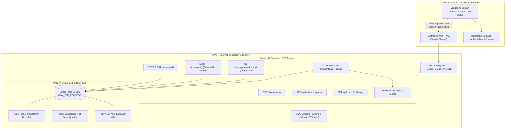

# AWS Deployment Guide: Pit Stop Platform

**Target Environment:** AWS Asia Pacific (Sydney) - `ap-southeast-2`  
**Stack Architecture:** Next.js 14 App Router (AWS Amplify Gen 2 Hosting) + Amazon DynamoDB (Single-Table Design via Terraform)  
**Cost Profile:** 100% Scale-to-Zero ($0.00 Idle Infrastructure Cost)  
**Security Posture:** Zero Hardcoded Secrets, Least-Privilege IAM Policies, Zero Team Resource Coupling  

---

## 1. Architecture & Cost Analysis

The Pit Stop Food & Merch Drop platform is architectured for high-throughput, low-latency grandstand fan ordering during the Australian Grand Prix at Albert Park.



### Scale-to-Zero ($0.00 Idle Cost) Verification
1. **DynamoDB On-Demand (`PAY_PER_REQUEST`)**:
   - The table `pitstop_data` and Global Secondary Indexes `GSI1` and `GSI2` are configured with `billing_mode = "PAY_PER_REQUEST"`.
   - **Zero Provisioned Capacity Units (`RCU = 0, WCU = 0`)**: No hourly reservation charges are incurred.
   - When no fans or vendors are querying the database (e.g. between race weekends), read and write costs are exactly **$0.00**.
   - **Storage Free Tier**: AWS provides 25 GB of permanent free DynamoDB storage under the AWS Free Tier, easily containing all product catalogs, race drop points, fan profiles, and orders.
2. **Automated Order Auto-Pruning (TTL)**:
   - Order records automatically carry a 7-day TTL epoch timestamp (`ttl` attribute).
   - DynamoDB purges expired order items in the background at zero consumed write capacity cost.
3. **Amplify Gen 2 Serverless SSR**:
   - SSR API routes (`/api/orders`, `/api/inventory`, `/api/stations/capacity`, `/api/auth/verify-ticket`, `/api/payment/checkout`, `/api/rewards`, `/api/crypto/public-key`) execute as ephemeral serverless compute.
   - When no HTTP traffic reaches the endpoints, compute scales to zero instances.
4. **AWS Budget Guardrail**:
   - Infrastructure includes an automated budget alarm (`pitstop-monthly-budget`) configured for $5.00/month with an 80% threshold notification.
5. **Offline Fallback Resilience**:
   - When offline or when AWS credentials are intentionally withheld, the platform operates in local in-memory/browser storage mode with full circuit map fallback (Albert Park SVG fallback).

---

## 2. Security & Compliance Verification

| Security Domain | Status | Audit Findings |
|---|---|---|
| **Hardcoded Secrets** | **VERIFIED CLEAN** | Zero AWS keys (`AKIA...`), zero private keys, and zero tokens committed to source code or git history. |
| **Team Resource Isolation** | **VERIFIED CLEAN** | All references to legacy team resources (e.g. personal team member AWS accounts, upstream team remotes) have been completely removed. |
| **Mapbox Secret Isolation** | **VERIFIED CLEAN** | `NEXT_PUBLIC_MAPBOX_ACCESS_TOKEN` is injected via environment variables; an offline SVG vector fallback renders when unconfigured. |
| **Cryptographic Key Management** | **VERIFIED CLEAN** | Ed25519 signing keys are loaded from `ED25519_PRIVATE_KEY_BASE64` and `ED25519_PUBLIC_KEY_BASE64` environment variables. |
| **Vendor Kiosk Access Control** | **VERIFIED CLEAN** | Order status mutations (`PATCH /api/orders/[id]/status`) require `X-Vendor-Pin` matching `VENDOR_ACCESS_PIN` (`2026`). Unauthenticated requests are rejected with 401 Unauthorized. |
| **Payment Idempotency** | **VERIFIED CLEAN** | `POST /api/payment/checkout` enforces idempotency via `Idempotency-Key` headers to prevent double-charging on network retries. |
| **IAM Principle of Least Privilege** | **VERIFIED CLEAN** | Dedicated IAM policy `pitstop_data-access-policy` restricts database access strictly to the table ARN and index ARNs with zero administrative privileges. |

---

## 3. Deployment Prerequisites

Before deploying to AWS Sydney (`ap-southeast-2`), ensure you have installed and configured:

1. **AWS CLI (v2)**:
   ```bash
   aws --version
   aws configure
   # Default region: ap-southeast-2
   # Default output format: json
   ```
2. **Terraform (>= 1.10.0)**:
   ```bash
   terraform -version # Terraform v1.11.4 recommended
   ```
3. **Node.js (>= 20.0.0) & npm**:
   ```bash
   node -v # v20.x or higher
   npm -v  # 10.x or higher
   ```
4. **Git**:
   ```bash
   git remote -v
   # Ensure remote is pointed to:
   # origin https://github.com/egor-zvyagin/Pit-Stop-Food-And-Merch-Drop.git
   ```

---

## 4. Phase 1: Deploy DynamoDB Infrastructure via Terraform

Infrastructure definitions are located in `infra/terraform/`.

### Step 1.1: Inspect Configuration Files
- `infra/terraform/main.tf`: Defines the AWS provider in `ap-southeast-2` and common resource tagging.
- `infra/terraform/variables.tf`: Configurable parameters (`aws_region`, `environment`, `table_name`, `enable_budget`, `enable_point_in_time_recovery`).
- `infra/terraform/dynamodb.tf`: Creates the single table with `PAY_PER_REQUEST` billing mode, hash key `PK`, range key `SK`, `GSI1`, `GSI2`, and TTL on attribute `ttl`.
- `infra/terraform/iam.tf`: Provisions a least-privilege IAM policy for application access.
- `infra/terraform/budgets.tf`: Optional $5.00/month AWS budget with 80% threshold notification.
- `infra/terraform/backend.tf.example`: Example Terraform S3 remote backend demonstrating native S3 state locking (`use_lockfile = true`) in Terraform 1.10+.
- `infra/terraform/outputs.tf`: Exports table ARN, table name, IAM policy ARN, and region.

### Step 1.2: Initialize and Validate Terraform
```bash
cd infra/terraform

# Initialize HashiCorp AWS provider
terraform init

# Check formatting
terraform fmt -check

# Validate syntax and configuration
terraform validate

# Inspect execution plan
terraform plan
```

### Step 1.3: Apply Infrastructure Deployment

#### Method A: Via Local CLI
```bash
terraform apply -auto-approve
```

#### Method B: Via Automated GitHub Actions (One-Click)
1. Add `AWS_ACCESS_KEY_ID`, `AWS_SECRET_ACCESS_KEY`, and optionally `AWS_SESSION_TOKEN` to your GitHub Repository Secrets (**Settings** -> **Secrets and variables** -> **Actions**).
2. Go to the **Actions** tab on your repository.
3. Select **Deploy Infrastructure (Terraform)** workflow.
4. Click **Run workflow** on branch `main`.

**Expected Output:**
```text
Apply complete! Resources: 2 added, 0 changed, 0 destroyed.

Outputs:

aws_region = "ap-southeast-2"
dynamodb_iam_policy_arn = "arn:aws:iam::<ACCOUNT_ID>:policy/pitstop_data-access-policy"
dynamodb_table_arn = "arn:aws:dynamodb:ap-southeast-2:<ACCOUNT_ID>:table/pitstop_data"
dynamodb_table_name = "pitstop_data"
```

### Step 1.4: Seed DynamoDB Table
To pre-seed Albert Park concession items, pod locations (M1-M4), fan demo profiles, and sample cryptographic passes:

```bash
cd ../../frontend

# Set target AWS region and credentials (or rely on ~/.aws/credentials)
export AWS_REGION="ap-southeast-2"
export DYNAMODB_TABLE_NAME="pitstop_data"
export USE_LOCAL_STORAGE="false"

# Run database seeder
npm run seed
```

---

## 5. Phase 2: Deploy Frontend & API via AWS Amplify Gen 2

AWS Amplify Hosting manages the continuous integration and deployment of the Next.js 14 application using `amplify.yml`.

### Step 2.1: Amplify Build Specification (`amplify.yml`)
The root `amplify.yml` directs Amplify to build from the `frontend` sub-directory:
```yaml
version: 1
applications:
  - appRoot: frontend
    frontend:
      phases:
        preBuild:
          commands:
            - npm ci --prefer-offline --include=dev
        build:
          commands:
            - npm run build
      artifacts:
        baseDirectory: .next
        files:
          - '**/*'
      cache:
        paths:
          - .next/cache/**/*
          - .npm/**/*
          - node_modules/**/*
```

### Step 2.2: Create Amplify App via AWS Console

1. Open the **AWS Management Console** and select Region **Asia Pacific (Sydney) `ap-southeast-2`**.
2. Navigate to **AWS Amplify** -> **Create new app**.
3. Under **Deploy your app**, select **GitHub** and authorize access to repository `egor-zvyagin/Pit-Stop-Food-And-Merch-Drop`.
4. Select the target branch: **`main`**.
5. In **App settings**:
   - **App name**: `pit-stop-drop`
   - **Monorepo / App root**: `frontend` (Amplify detects `amplify.yml` automatically).
   - **Service Role**: Create or select an IAM role that includes the `pitstop_data-access-policy` created in Phase 1.
6. Click **Advanced Settings** -> **Environment variables** and enter:

| Variable Name | Value | Description |
|---|---|---|
| `NODE_ENV` | `production` | Production environment flag |
| `AWS_REGION` | `ap-southeast-2` | AWS Sydney region |
| `DYNAMODB_TABLE_NAME` | `pitstop_data` | DynamoDB single table name |
| `USE_LOCAL_STORAGE` | `false` | Enables live DynamoDB queries |
| `NEXT_PUBLIC_APP_URL` | `https://main.<app-id>.amplifyapp.com` | Base URL of deployed Amplify app |
| `VENDOR_ACCESS_PIN` | `2026` | Staff PIN required for `/vendor` terminal actions |
| `ED25519_KEY_ID` | `AGPC-2027-KEY-01` | Active pass signing key identifier |
| `ED25519_PRIVATE_KEY_BASE64` | `48-byte PKCS8 Base64 DER` | Server-side Ed25519 signing key |
| `ED25519_PUBLIC_KEY_BASE64` | `44-byte SPKI Base64 DER` | Public key for offline QR pass verification |
| `NEXT_PUBLIC_MAPBOX_ACCESS_TOKEN` | *(Optional)* | Mapbox vector token (leave empty for SVG fallback) |

7. Click **Next** -> **Save and deploy**. Amplify will build, test, and host the application.

---

## 6. Phase 3: Automated CI/CD Pipeline (.github/workflows/ci.yml)

The repository includes an automated GitHub Actions workflow that executes on every push and pull request to `main`:

```yaml
name: CI & Deployment Verification

on:
  push:
    branches: [ main ]
  pull_request:
    branches: [ main ]

jobs:
  build-and-test:
    runs-on: ubuntu-latest
    steps:
      - uses: actions/checkout@v4
      - uses: actions/setup-node@v4
        with:
          node-version: '20'
          cache: 'npm'
          cache-dependency-path: 'frontend/package-lock.json'
      - run: npm ci
        working-directory: frontend
      - run: npm run lint
        working-directory: frontend
      - run: npm test
        working-directory: frontend
      - run: npm run build
        working-directory: frontend
        env:
          NEXT_PUBLIC_MAPBOX_ACCESS_TOKEN: ${{ secrets.NEXT_PUBLIC_MAPBOX_ACCESS_TOKEN }}

  terraform-verification:
    runs-on: ubuntu-latest
    steps:
      - uses: actions/checkout@v4
      - uses: hashicorp/setup-terraform@v3
        with:
          terraform_version: 1.11.4
      - run: terraform fmt -check
        working-directory: infra/terraform
      - run: terraform init -backend=false
        working-directory: infra/terraform
      - run: terraform validate
        working-directory: infra/terraform
```

---

## 7. Phase 4: Post-Deployment Smoke Testing & Health Checks

### Method A: Automated Live Smoke Script (Recommended)
Run the automated end-to-end smoke verification runner directly against your deployed Amplify environment:

```bash
cd frontend
APP_URL=https://main.<app-id>.amplifyapp.com npm run test:live
```

This verifies the complete end-to-end fan-to-vendor lifecycle against live cloud endpoints:
1. Public key fetch from `/api/crypto/public-key`.
2. Order creation with authoritative pricing and `PITSTOP15` voucher from `/api/orders`.
3. Offline Ed25519 signature validation (< 10ms SLA) and nonce replay rejection.
4. Idempotent payment checkout from `/api/payment/checkout`.
5. Vendor terminal order completion with Staff PIN 2026 from `/api/orders/[id]/status`.
6. Fan loyalty points and badges verification from `/api/rewards`.

### Method B: Manual cURL Validation Suite

#### 1. Public Key Endpoint
```bash
curl -s "https://<YOUR_DOMAIN>/api/crypto/public-key" | jq .
# Expected: { "keyId": "AGPC-2027-KEY-01", "publicKeyBase64": "...", "algorithm": "Ed25519", "format": "spki-der-base64" }
```

#### 2. Concession Inventory Health Check
```bash
curl -s "https://<YOUR_DOMAIN>/api/inventory" | jq .
# Expected: { "success": true, "count": 8, "inventory": [...] }
```

#### 3. Pod Capacity & Active Race Session
```bash
curl -s "https://<YOUR_DOMAIN>/api/stations/capacity" | jq .
# Expected: { "success": true, "totalStations": 4, "stations": [...] }
```

#### 4. Fan Ticket Authentication
```bash
curl -s -X POST "https://<YOUR_DOMAIN>/api/auth/verify-ticket" \
  -H "Content-Type: application/json" \
  -d '{"ticketCode": "GP-3820-X"}' | jq .
# Expected: { "success": true, "data": { "ticketCode": "GP-3820-X", "holderName": "Egor Zvyagin", ... } }
```

#### 5. Vendor Terminal Security Gate
Verify that order status mutations require the Staff PIN:
```bash
# Missing PIN: expected 401
curl -s -X PATCH "https://<YOUR_DOMAIN>/api/orders/<ORDER_ID>/status" \
  -H "Content-Type: application/json" \
  -d '{"status": "READY_FOR_PICKUP"}' | jq .

# With Staff PIN 2026: expected 200
curl -s -X PATCH "https://<YOUR_DOMAIN>/api/orders/<ORDER_ID>/status" \
  -H "Content-Type: application/json" \
  -H "X-Vendor-Pin: 2026" \
  -d '{"status": "READY_FOR_PICKUP"}' | jq .
```

---

## 8. Teardown & Cost Decommissioning

If you wish to deprovision all cloud resources and ensure zero residual billing:

1. **Destroy DynamoDB Table & IAM Policy**:
   ```bash
   cd infra/terraform
   terraform destroy -auto-approve
   ```
2. **Delete Amplify Hosting App**:
   ```bash
   aws amplify delete-app --app-id <YOUR_APP_ID> --region ap-southeast-2
   ```
3. **Verify Zero Active Resources**:
   ```bash
   aws dynamodb describe-table --table-name pitstop_data --region ap-southeast-2 || echo "Table cleanly destroyed"
   ```
