# Pit Stop: Food & Merch Drop Ecosystem

**Order ahead. Pick up fast. Get back to the on-track action.**  
*Commissioned for the Australian Grand Prix Corporation (AGPC) Fan Experience Innovation Project.*

[](https://nextjs.org/)
[](https://www.typescriptlang.org/)
[](https://tailwindcss.com/)
[](./frontend/src/__tests__)
[](./frontend/e2e)
[](https://maplibre.org/)
[](./frontend/src/lib/db)
[](./frontend/src/app/api/circuit)
[](./infra/terraform)
[](./infra/terraform/oidc.tf)
[](./infra/terraform/observability.tf)
[](./frontend/src/lib/crypto)
[](https://aws.amazon.com/)

---

## About this repository

This is Egor Zvyagin's continued, solo development of Pit Stop. The project began as an RMIT capstone (COSC2408, Team 28) built for the Australian Grand Prix Corporation, and the original team is credited [below](#original-capstone-team). Work after the capstone continues in this fork.

It is a working prototype, not a production service. [What is real and what is simulated](#what-is-real-and-what-is-simulated) says exactly which parts are which.

---

## Live Deployment

| Service | Target URL | Credentials / Parameters | Description |
|---|---|---|---|
| **Fan Web Application** | [https://main.d3m92lj3xoqgf9.amplifyapp.com](https://main.d3m92lj3xoqgf9.amplifyapp.com) | Ticket: `GP-3820-X` | Mobile-optimized fan ordering, live tracker, digital pass & history |
| **Vendor Kiosk Terminal** | [https://main.d3m92lj3xoqgf9.amplifyapp.com/vendor](https://main.d3m92lj3xoqgf9.amplifyapp.com/vendor) | Staff PIN: set in `VENDOR_ACCESS_PIN` (not published) | Concession terminal with 8-bay lockers, race control & offline outbox |
| **Public Key Endpoint** | [https://main.d3m92lj3xoqgf9.amplifyapp.com/api/crypto/public-key](https://main.d3m92lj3xoqgf9.amplifyapp.com/api/crypto/public-key) | None (Public / Cached) | Ed25519 public key in SPKI DER Base64 format |
| **Secondary Demo Ticket** | [https://main.d3m92lj3xoqgf9.amplifyapp.com](https://main.d3m92lj3xoqgf9.amplifyapp.com) | Ticket: `GP-9014-P` | Second demo profile (Brabham Grandstand, Turn 4) |
| **Target AWS Region** | `ap-southeast-2` (Sydney) | Profile: `personal` | 100% Serverless scale-to-zero ($0.00 idle infrastructure cost) |

The ticket codes above are seeded sample profiles, not credentials. The staff PIN is a secret and is not published; ask the repository owner for demo access to the vendor terminal.

---

## Platform Architecture (v3.0 Production Platform)

```mermaid
flowchart TD
    subgraph ClientLayer["Client & Kiosk Layer"]
        FanPWA["Fan Mobile Web / PWA\n(Group Orders, Live Tracker /track/[orderId], History)"]
        VendorKiosk["Trackside Concession Kiosk (/vendor)\n(Staff PIN, 8-Bay Lockers, Race Control Panel)"]
        OfflineSyncOutbox["Offline Fulfillment Outbox (syncQueue.ts)\n(Airplane Mode Simulator + Auto-Sync)"]
        OfflineEngine["Isomorphic Ed25519 Verifier (@noble/curves)"]
        LocalCache["OfflineNonceRegistry (Replay Cache)"]
        
        VendorKiosk --> OfflineEngine
        OfflineEngine --> LocalCache
        VendorKiosk --> OfflineSyncOutbox
    end

    subgraph AWSCloud["AWS Asia Pacific - Sydney (ap-southeast-2)"]
        CloudFront["AWS Amplify Hosting / CloudFront CDN"]
        
        subgraph ServerlessCompute["Next.js 14 Serverless SSR (Amplify Hosting)"]
            CatalogAPI["/api/inventory & /api/inventory/restock"]
            RaceControlAPI["/api/circuit/status (Live Flags: Green, Safety Car, Red, Post-Race)"]
            StationAPI["/api/stations/capacity & /api/stations/lockers (#01..#08)"]
            OrderAPI["/api/orders (Zod Schema, Token-Bucket Rate Limiter, TransactWriteItems)"]
            HistoryAPI["/api/orders/history (GSI1 Fan Queries)"]
            PublicTrackAPI["/api/orders/[id]/public (Zero-Secret Read-Only Tracking)"]
            StatusAPI["/api/orders/[id]/status (Staff PIN Guard)"]
            PaymentAPI["/api/payment/checkout (Simulated Payment)"]
            RewardsAPI["/api/rewards (Loyalty Points & Badges)"]
            CryptoAPI["/api/crypto/public-key (SPKI Ed25519)"]
            PassSigner["Server Ed25519 Pass Signer (crypto.sign)"]
        end

        subgraph DatabaseLayer["Amazon DynamoDB (pitstop_data)"]
            SingleTable[("Single-Table Design (PAY_PER_REQUEST)")]
            ItemRecords["ITEM#<id> (stock, isLimitedDrop)"]
            OrderRecords["ORDER#<id> (TTL, Express Locker Bay Assignment)"]
            CircuitRecord["CIRCUIT#STATUS (Dynamic Flag State)"]
            GSI1["GSI1: Ticket Code History (TICKET#<ticketCode>)"]
            GSI2["GSI2: Counter & PIN Lookup (PIN#<pinCode>)"]
            TTL["7-Day Order Auto-Pruning (ttl)"]
        end

        subgraph DevOpsInfra["Infrastructure as Code & Observability"]
            S3State["S3 Remote State Bucket\n(pitstop-tfstate-608531435714-ap-southeast-2\nuse_lockfile = true)"]
            OIDCAuth["GitHub Actions Keyless OIDC\n(token.actions.githubusercontent.com)"]
            CloudWatchDash["CloudWatch Dashboard\n(pitstop-production-dashboard)"]
            Alarm["DynamoDB SystemErrors Alarm\n(pitstop-dynamodb-system-errors)"]
        end
    end

    FanPWA --> CloudFront
    CloudFront --> ServerlessCompute
    OrderAPI --> PassSigner
    OrderAPI -->|"Atomic TransactWriteItems\n(ConditionCheckItem stock >= qty)"| SingleTable
    HistoryAPI --> SingleTable
    PublicTrackAPI --> SingleTable
    RaceControlAPI --> SingleTable
    StationAPI --> SingleTable
    PaymentAPI --> SingleTable
    StatusAPI --> SingleTable
    RewardsAPI --> SingleTable
    VendorKiosk -.->|"Offline Airplane Mode Scans (< 10ms SLA)"| FanPWA
    OfflineSyncOutbox -.->|"Auto-Flush on Reconnection"| StatusAPI
```



---

## Executive Overview

**Pit Stop: Food & Merch Drop** is an enterprise fan-engagement and race-day logistics ecosystem architected for high-density public sports events. During peak Formula 1 race sessions at Albert Park, over 100,000 concurrent spectators place extreme load on trackside cellular towers and concession outlets, leading to severe network latency, dropped packets, and 45+ minute concession queues.

Pit Stop mitigates these operational bottlenecks through:

1. **Intelligent In-App Ordering & Scheduled Pickups:** Fans order meals and merchandise ahead, receiving precise collection windows synchronized with support races to bypass queues.
2. **Dynamic Geospatial Routing Across 4 Calibrated Concession Pods (M1-M4):** Powered by **Zero-Key MapLibre GL v5** and **OpenFreeMap vector tiles** with offline Dijkstra pedestrian routing around Albert Park Lake:
   * **Pod M1 (Main Straight / Pit Exit):** Calibrated at `(-37.8496, 144.9690)`, serving Fangio, Senna, and Prost Grandstands.
   * **Pod M2 (Turn 9 East / Clark):** Calibrated at `(-37.8442, 144.9746)`, serving Waite and Clark Grandstands.
   * **Pod M3 (Turn 4 / Lakeside Drive):** Calibrated at `(-37.8415, 144.9648)`, serving Brabham and Jones Grandstands.
   * **Pod M4 (Turn 14 / GA Village):** Calibrated at `(-37.8534, 144.9718)`, serving General Admission and Village Precinct.
3. **Dynamic Concession Yield Pricing Engine:** Modeled after EatClub's dynamic yield management, the platform dynamically triggers automated off-peak discounts (`GREEN_FLAG` 10%, `POST_RACE` 15%) and concourse surge pricing (`SAFETY_CAR` 0%, `RED_FLAG` 0%) to flatten crowd surges away from race finishes.
4. **Sub-10ms Offline Cryptographic Verification:** When mobile networks collapse trackside, customer order passes are validated offline via asymmetric Ed25519 digital signatures in under **10 ms** (typically **0.1 ms - 1.5 ms**) with zero cloud network requests.

---

## Pit Stop v3.0: Production Platform Upgrade

Pit Stop v3.0 elevates the ecosystem into a resilient, production-hardened platform:

### 1. Atomic Concurrency & Stock Protection (DynamoDB `TransactWriteItems`)
- **Race Condition Immunity:** When limited-edition merchandise drops (e.g. `gp-cap-2026`, `ferrari-tee`) are contested by hundreds of fans simultaneously, `db.createOrderAtomic` combines item stock updates with order creation in an ACID `TransactWriteItems` operation.
- **Stock Condition Checks:** `ConditionExpression: "attribute_exists(PK) AND stock >= :qty"` guarantees overselling is impossible.
- **409 Conflict Recovery:** If stock runs out during checkout, the server throws `InsufficientStockError` and returns `409 Conflict` with code `INSUFFICIENT_STOCK`. The mobile UI catches this and presents a 1-tap "Adjust Cart to Available Stock" action.

### 2. Live Race Control Flag Dynamic Pricing
- **Live Circuit State Engine:** Persisted at `CIRCUIT#STATUS` and exposed via public `GET /api/circuit/status` and vendor-guarded `PATCH /api/circuit/status`.
- **Dynamic Yield Calibration:**
  * **`GREEN_FLAG`:** 10% off-peak concession discount, 1.0x queue multiplier (*"Track Session Active — Off-Peak Pit Stop Savings Open"*).
  * **`SAFETY_CAR`:** 0% off-peak discount (surge paused), 1.6x queue multiplier (*"Safety Car Deployed — Surge Concourse Traffic"*).
  * **`RED_FLAG`:** 0% off-peak discount, 2.0x queue multiplier (*"Red Flag Halt — Peak Concourse Surge"*).
  * **`POST_RACE`:** 15% post-race merch drop deals, 1.2x queue multiplier (*"Checkered Flag — Post-Race Merch Drop Deals Active"*).
- **Live Circuit Banner:** Polled at 10s intervals (pausing when tab is backgrounded) and seamlessly integrated into Home, Order, and Checkout pages.

### 3. Smart Locker Bay Allocation (`#01`..`#08`)
- **Express Locker Management:** Automated allocation of express locker slots `#01` through `#08` at each concession pod based on active orders (`RECEIVED`, `PREPARING`, `READY_FOR_PICKUP`), with graceful overflow queue `#Q1`..`#Q20`. Allocation reads current orders and then assigns, so it is not yet atomic (see known limits).
- **Vendor Locker Grid (`LockerBayGrid.tsx`):** Real-time 8-bay interactive grid on the vendor kiosk indicating Available, Preparing, and Ready orders with quick customer PIN identification.

### 4. Offline Fulfillment Outbox Synchronization (`syncQueue.ts`)
- **Trackside Airplane Mode Resilience:** Concession staff can operate uninterrupted during catastrophic cellular blackouts.
- **LocalStorage Outbox (`pitstop_vendor_sync_queue_v1`):** Order lifecycle transitions performed in offline mode are enqueued into an outbox, updating kiosk UI optimistically.
- **Automatic Reconnection Flush:** Uses browser `online` events to automatically flush the outbox to `PATCH /api/orders/[id]/status` upon network restoration, complete with retry tracking and error toasts.

### 5. Fan Order History & Zero-Secret Public Tracking
- **Fan Order History (`/api/orders/history?ticketCode=...`):** High-speed GSI1 queries sorted newest-first, providing fans with order logs, receipt totals, and 1-tap reordering. Vendor orders endpoint `GET /api/orders` remains strictly protected behind `X-Vendor-Pin`.
- **Zero-Secret Public Live Tracker (`/track/[orderId]`):** Shareable link allowing row mates to monitor order preparation. An order ID only ever unlocks a progress view. The collection PIN and signed QR pass are returned solely to the order's owner (who sends the order PIN) or to staff (who send the staff PIN), and order history never includes them.
- **Group Order Mode:** Single spectator row-collector ordering with optional seat notes (e.g. *"Clark Stand Row H, Seats 14-16"*).

### 6. Production Infrastructure as Code (Terraform & AWS)
- **S3 Remote State with Native Lockfiles:** Migrated to S3 bucket `pitstop-tfstate-608531435714-ap-southeast-2` using Terraform S3 backend with `use_lockfile = true` for cost-free, distributed state locking.
- **GitHub Actions Keyless OIDC Federation:** Provisioned IAM OpenID Connect provider for `token.actions.githubusercontent.com` and deployment role `pitstop-github-actions-terraform-role`, assumable only from this repository's `main` branch, eliminating long-lived AWS access keys.
- **CloudWatch Observability Dashboard & Alarms:** Provisioned free-tier dashboard `pitstop-production-dashboard` visualizing DynamoDB consumed RCU/WCU, latency percentiles, and alarm `pitstop-dynamodb-system-errors` (no notification target is attached yet).

---

## What is real and what is simulated

**Real, and covered by tests**
- Ordering with server-side pricing, and atomic stock decrement in one DynamoDB transaction.
- Ed25519-signed passes, verified offline at the vendor terminal with replay detection.
- Vendor terminal, race-control flags, locker grid and the offline outbox that syncs on reconnect.
- Live stock on the menu, order history, and the shareable progress tracker.
- Installable PWA: the app shell and the vendor terminal open with no connection after one online visit.
- DynamoDB persistence. A database failure returns an error; nothing is answered from memory.
- Infrastructure as code (Terraform), keyless CI through GitHub OIDC, and one verify script shared by local runs and CI.

**Simulated, and labelled as such**
- **Payment.** There is no payment provider. Checkout says so on screen, and the payment endpoint only marks an order as paid for a caller holding that order's PIN.
- **Ticket verification.** Two sample ticket profiles are seeded, and any other code beginning `GP-` is accepted as a generic fan. There is no link to a real ticketing system.
- **Demo Mode.** On by default and switchable in Settings. It advances an order through its stages on a timer and, with no connection, creates a local sample order.
- **Pod queue and walk times.** Seeded values scaled by the race flag, not live sensor data.
- **Trackside location.** "Simulate Trackside" places you at the circuit for demonstrations.

**Known limits**
- Rate limiting and payment idempotency keys are held in memory per server instance, so they are best-effort on serverless.
- Rewards history and the "points already awarded" check are also per instance.
- Locker bay allocation is not atomic: two orders placed at the same moment can be given the same bay.
- A fan is identified by ticket code alone, and the collection PIN is four digits.
- Tests run on the in-memory store. The DynamoDB code path is tested with a stubbed client, not against a real table.
- `npm audit` reports 7 advisories that need major upgrades (Next.js 14 to 16, MapLibre GL 5 to 6).
- The GitHub Actions deployment role can manage IAM more broadly than this project needs.

---

## Test Suite & Verification Results

Pit Stop v3.0 features extensive automated testing across unit, integration, crypto, concurrency, security, and Playwright end-to-end browser automation.

```
✓ src/__tests__/geo.test.ts                    (24 tests)
✓ src/__tests__/crypto.test.ts                 (11 tests)
✓ src/__tests__/secrets.test.ts                (11 tests)
✓ src/__tests__/pricing.test.ts                (10 tests)
✓ src/__tests__/api.test.ts                     (9 tests)
✓ src/__tests__/v3Features.test.ts              (9 tests)
✓ src/__tests__/dbFailure.test.ts               (8 tests)
✓ src/__tests__/orderAccess.test.ts             (6 tests)
✓ src/lib/offline/__tests__/syncQueue.test.ts   (6 tests)

Test Files  9 passed (9)
     Tests  94 passed (94)
```

Three suites guard the hardening work: `secrets.test.ts` (no PIN or key configured means requests are refused), `orderAccess.test.ts` (an order ID or ticket code never unlocks a PIN or pass) and `dbFailure.test.ts` (a failing DynamoDB returns an error, never invented data).

### Suite Breakdown

1. **`v3Features.test.ts` (9 Tests) — Concurrency, Security, Lockers & Offline Sync:**
   - **Atomic Merch Drop Concurrency:** Simulates two concurrent `POST /api/orders` racing for a limited merch item (`stock: 1`). Asserts exactly one returns `201 Created` and one returns `409 Conflict` with code `INSUFFICIENT_STOCK`, leaving final stock `0`.
   - **Race Control Flag Pricing:** Toggles `CircuitState` from `GREEN_FLAG` (10% off) to `SAFETY_CAR` (0% off) via API and asserts order pricing dynamically updates.
   - **Smart Locker Allocation:** Verifies concurrent orders at the same pod station allocate distinct, collision-free bay numbers `#01`..`#08`.
   - **Fan Order History vs Vendor Guard:** Confirms `GET /api/orders/history?ticketCode=...` returns customer orders, while `GET /api/orders` strictly requires `X-Vendor-Pin` (rejecting unauthenticated requests with 401).
   - **Zero-Secret Public Tracker Contract:** Verifies `GET /api/orders/[id]/public` returns status and order details while asserting `qrPayload`, `signatureBase64`, and `pinCode` are strictly `undefined`.
   - **Offline Sync Outbox:** Enqueues status actions into `syncQueue.ts` and asserts flushing against the serverless status route resolves cleanly with 0 failures.
   - **Zod Schema Validation:** Verifies malformed JSON, empty items, and negative quantities return 400 with descriptive issue details.

2. **`syncQueue.test.ts` (6 Tests):**
   - Outbox queue storage persistence in localStorage.
   - Idempotent action deduplication and attempt tracking.
   - Dequeuing on 200 OK and 409 Conflict (order already completed).
   - Online event listener lifecycle.

3. **`geo.test.ts` (24 Tests):**
   - Haversine distance calculations benchmarked against known Albert Park surveys.
   - High-accuracy GPS geofence classification (`2.5 km` threshold).
   - 16-node undirected walkway graph wrapping Albert Park Lake.
   - Dijkstra pedestrian route navigation skirting lake shores.
   - Total time pod ranking (`rankStationsByTotalTime`).

4. **`crypto.test.ts` (11 Tests):**
   - Server-side Ed25519 cryptographic signing (`AGPC1.*`).
   - Sub-10ms offline verification SLA via `@noble/curves`.
   - Nonce replay attack mitigation (`REPLAY_DETECTED`).
   - Tampered payload and forged signature rejection.

5. **`pricing.test.ts` (10 Tests):**
   - Authoritative catalog pricing engine.
   - Dynamic yield green flag vs safety car surge rules.
   - Promotional code `PITSTOP15` and voucher discounts.
   - Service fee rounding and loyalty points accrual.

6. **`api.test.ts` (9 Tests):**
   - Serverless route handler contracts for orders, payment, public keys, inventory, stations, and rewards.

---

### Playwright Dual-Persona Browser E2E Suite

Playwright tests simulate complete customer and vendor journeys across realistic device viewports. They run against the production build (`next build` + `next start`) on the in-memory store, 6 tests in total:

```bash
cd frontend
npm run test:e2e
```

- **Mobile Fan Flow (`Pixel 7` Viewport):**
  1. Loads `/` without severe console errors.
  2. Toggles Trackside Simulation and selects a Grandstand preset.
  3. Navigates to `/order`, confirms stock pills and photographic assets render.
  4. Adds items to cart, proceeds to `/checkout`.
  5. Toggles Group Order and fills in seat notes.
  6. Places order, verifies redirect to `/collect` or `/pass` with Ed25519 pass.
  7. Clicks Share Live Tracker, navigates to `/track/[orderId]`, asserts status stepper renders and zero QR/PIN is exposed.
  8. Checks Order History tab on `/collect` and verifies past orders render.

- **Offline App Shell (both viewports):** visits once online, switches the network off, then confirms the fan app and the vendor terminal still open from the service worker cache.

- **Tablet Kiosk Vendor Flow (`1280x800` Viewport):**
  1. Navigates to `/vendor`.
  2. Unlocks with the staff PIN given to the test server.
  3. Asserts 8-bay Locker Grid and Telemetry Bar render.
  4. Toggles Race Control flag.
  5. Enables Airplane Mode Simulator, marks order complete, asserts `"Pending Cloud Sync"` count increases.
  6. Toggles Airplane Mode OFF, asserts auto-sync fires and queue clears.

---

### End-to-End Live Smoke Runner

Run the full end-to-end fan-to-vendor scenario:
```bash
cd frontend
npm run test:live
```

Output:
```
======================================================
🏎️  PIT STOP v3.0: END-TO-END SMOKE VERIFICATION SUITE
======================================================

⚡ Target mode: In-Process Next.js Serverless Route Dispatch (Standalone)
▶ STEP 1: Checking Live Race Control via GET /api/circuit/status...
  ✓ Circuit Flag: GREEN_FLAG (10% off-peak discount)
  ✓ Race Message: "Track Session Active — Off-Peak Pit Stop Savings Open"

▶ STEP 2: Fetching Server Public Key via GET /api/crypto/public-key...
  ✓ Algorithm: Ed25519 (spki-der-base64)
  ✓ Key ID: AGPC-2027-KEY-01
  ✓ SPKI Base64: MCowBQYDK2VwAyEA...
  ✓ Public key loaded into local passVerifier engine

▶ STEP 3: Submitting Order via POST /api/orders (PITSTOP15 Promo Applied)...
  ✓ Order Created: GP-2026-D8C8MQ
  ✓ Pickup Pod: Pit Stop M2 (Turn 9 East) (M2)
  ✓ Subtotal: $69.00 | Discount: -$10.35 (15% OFF)
  ✓ Service Fee: $1.47 | Final Total: $60.12
  ✓ Express Locker PIN: 7412
  ✓ Cryptographic QR: AGPC1.eyJvcmRlcklkIjoiR1AtMjAyNi1EOEM4TVEi...

▶ STEP 4: Offline Verification of Pass via @noble/curves (<10ms SLA)...
  ✓ Offline Signature Validated in 0.942 ms (Target < 10.0 ms SLA)
  ✓ Order ID decoded from QR: GP-2026-D8C8MQ
  ✓ Initial barcode scan registered in OfflineNonceRegistry
  ✓ Replay attack detected: duplicate scan rejected with REPLAY_DETECTED

▶ STEP 5: Auditing Public Read-Only Tracker via GET /api/orders/[id]/public...
  ✓ Public Tracker Order ID: GP-2026-D8C8MQ
  ✓ Public Status: RECEIVED
  ✓ Designated Locker Bay: #02
  ✓ Zero-Secret Contract Verified: qrPayload, pinCode & signatureBase64 are strictly UNDEFINED

▶ STEP 6: Querying Fan Order History via GET /api/orders/history?ticketCode=GP-3820-X...
  ✓ Found past orders for ticket GP-3820-X
  ✓ Verified order GP-2026-D8C8MQ listed in fan history (status: RECEIVED)

▶ STEP 7: Authorizing Payment via POST /api/payment/checkout...
  ✓ Payment Authorized: TxID smoke-tx-1795042838791 (apple_pay)
  ✓ Payment idempotency verified: identical transaction returned for duplicate submission

▶ STEP 8: Updating Order Status to COMPLETED via PATCH /api/orders/[id]/status...
  ✓ Security check: unauthorized PIN rejected with 401
  ✓ Vendor marked order COMPLETED (staff PIN verified)

▶ STEP 9: Verifying Fan Rewards Balance & Badges via GET /api/rewards...
  ✓ Holder Name: Egor Zvyagin (GP-3820-X)
  ✓ Loyalty Balance: 1970 pts (Tier: Pit Lane Insider)
  ✓ Badges Count: 4 badges (3 unlocked)
  ✓ Active Vouchers: 5 vouchers

▶ STEP 10: Executing Clean Teardown...
  ✓ Nonce registry flushed cleanly

======================================================
🏁 ALL 10 SMOKE TESTS PASSED PERFECTLY IN 885 ms!
======================================================
```

---

## Local Development Setup

### 1. Prerequisites
- **Node.js:** `>= 20.0.0` (v20.x or v22.x LTS)
- **npm:** `>= 10.0.0`

### 2. Clone & Install
```bash
git clone https://github.com/egor-zvyagin/Pit-Stop-Food-And-Merch-Drop.git
cd Pit-Stop-Food-And-Merch-Drop/frontend
npm ci
```

### 3. Environment Variables
Copy the sample environment file:
```bash
cp .env.example .env.local
```

Key variables:
```bash
NEXT_PUBLIC_APP_URL="http://localhost:3000"
VENDOR_ACCESS_PIN="<choose your own>"   # required: no default exists
ED25519_KEY_ID="AGPC-2027-KEY-01"
DYNAMODB_TABLE_NAME="pitstop_data"
AWS_REGION="ap-southeast-2"
```

Secrets have no built-in defaults:

- **`VENDOR_ACCESS_PIN`** must be set, or every vendor request is refused.
- **`ED25519_PRIVATE_KEY_BASE64`** signs the passes. `npm run dev` and the tests generate a throwaway key when it is empty. `npm run start`, `npm run seed` and any deployment need a real one: create it with `npm run keygen`.
- The vendor terminal fetches the matching public key from `/api/crypto/public-key` while online and caches it for offline scanning.

### 4. Seed the Database (DynamoDB only)
With `USE_LOCAL_STORAGE=true` (the default in `.env.example`) the app starts with sample data in memory and this step is not needed. To seed a real DynamoDB table, export your AWS credentials, `USE_LOCAL_STORAGE=false` and a signing key, then:
```bash
npm run seed
```

### 5. Run Development Server
```bash
npm run dev
```
Open [http://localhost:3000](http://localhost:3000) for the Fan Web App or [http://localhost:3000/vendor](http://localhost:3000/vendor) for the Vendor Terminal (it asks for the PIN you set in `VENDOR_ACCESS_PIN`).

### 6. Run Test Suites
```bash
# Run all Vitest unit, security and concurrency suites (94 tests)
npm test

# Run Playwright browser E2E suite against the production build (Mobile & Tablet Kiosk)
npm run test:e2e

# Run end-to-end 10-step smoke verification
npm run test:live

# Run linter
npm run lint

# Compile production build
npm run build

# Generate an Ed25519 signing keypair
npm run keygen
```

To run every check exactly as CI does, from the repository root (needs Terraform installed):
```bash
bash scripts/verify.sh
```

---

## Cloud Architecture & Cost Profile

The platform operates on a **100% Scale-to-Zero Serverless Architecture** in AWS Sydney (`ap-southeast-2`):

- **AWS Amplify Hosting:** Global CloudFront edge distribution + serverless SSR compute for Next.js.
- **Amazon DynamoDB Single-Table (`pitstop_data`):** On-demand billing (`PAY_PER_REQUEST`). Zero provisioned read/write capacity units (`RCU = 0, WCU = 0`). Under 25 GB AWS Free Tier limit, yielding **$0.00 idle cost**.
- **Atomic Concurrency Protection:** `TransactWriteItems` with conditional stock updates prevents overselling during flash merchandise drops without costly distributed locking services.
- **Terraform Remote S3 Backend:** State stored in `pitstop-tfstate-608531435714-ap-southeast-2` with `use_lockfile = true` for cost-free, DynamoDB-less native state locking.
- **GitHub Actions Keyless OIDC:** Secure role assumption via `token.actions.githubusercontent.com` eliminates long-lived secret storage.
- **CloudWatch Free-Tier Dashboard:** Dashboard `pitstop-production-dashboard` and alarm `pitstop-dynamodb-system-errors` operate within the AWS CloudWatch Free Tier (up to 3 free dashboards and 10 free alarms).
- **Automated Order Expiration (TTL):** Order records carry a 7-day TTL epoch attribute, automatically pruned by DynamoDB with zero consumed write capacity.
- **AWS Budget Protection:** A $5.00/month budget alert is defined in Terraform (`budgets.tf`) and is off by default; set `enable_budget = true` and a real notification email to turn it on.

For complete cloud deployment instructions, see [DEPLOYMENT_GUIDE.md](./DEPLOYMENT_GUIDE.md).

---

## Original Capstone Team

RMIT COSC2408, Team 28. Development after the capstone is by Egor Zvyagin alone.

| Name | Role & Specialisation | GitHub Profile |
|---|---|---|
| **Egor Zvyagin** | Product Owner / Full-Stack & Cloud Engineer | [@egor-zvyagin](https://github.com/egor-zvyagin) |
| **Hui Wen Chew** | UX / UI Design Lead | [@huiwenchew](https://github.com/huiwenchew) |
| **Sahibjeet Singh** | Developer & Quality Assurance Engineer | [@Sahib-11](https://github.com/Sahib-11) |
| **Muhammad Rayyan Sohail** | Business Analyst & Requirements Engineer | [@S4073657](https://github.com/S4073657) |

---

## Industry Presentation & Recognition

Delivered as part of the Australian Grand Prix Corporation (AGPC) Industry Engagement Initiative. Exclusively invited to present live technical demonstrations to AGPC Executive Stakeholders at AGPC Corporate Headquarters (St Kilda Road, Melbourne), and selected for the **RMIT UNAUTOMATED Showcase**.
