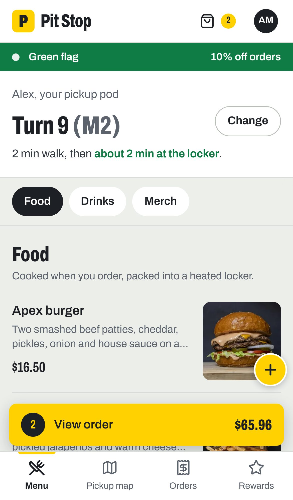
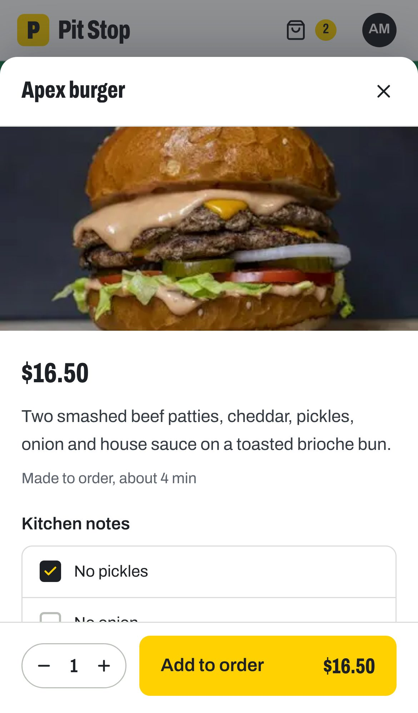
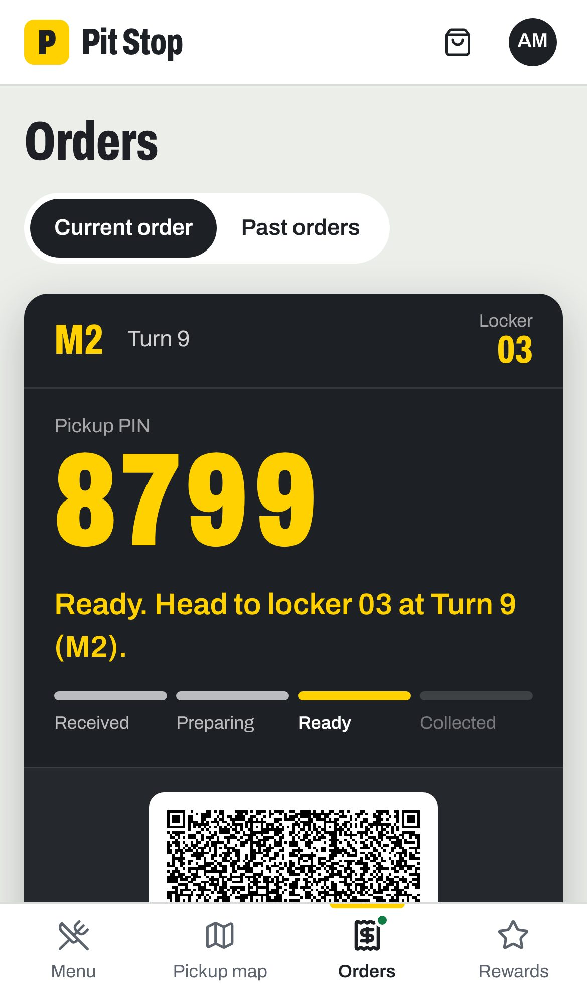
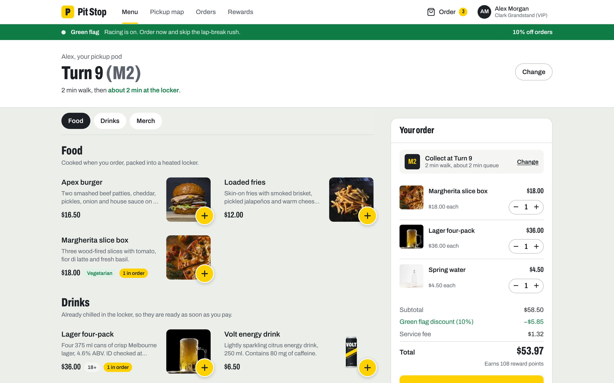
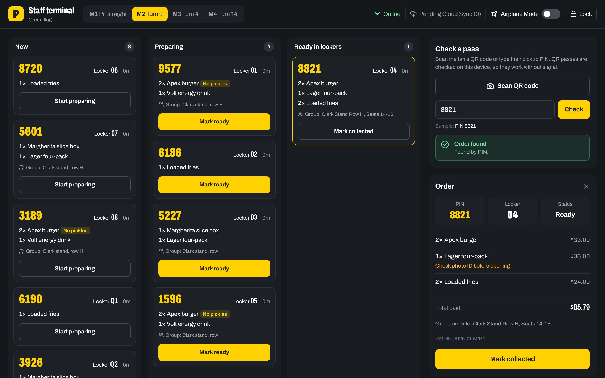

# Pit Stop

**Order food and merch from your grandstand seat, collect it from a locker, and miss less of the race.**

<p>
  
  
  
</p>



Next.js 15 · React 19 · TypeScript · Tailwind · DynamoDB · Terraform · Playwright

## About this repository

This is Egor Zvyagin's continued, solo development of Pit Stop. The project began as an RMIT capstone (COSC2408, Team 28) built with the Australian Grand Prix Corporation as industry partner, and the original team is credited [below](#original-capstone-team). Work after the capstone continues in this fork. The brand, products and artwork in the app are invented for this project and are not affiliated with any event, team or sponsor.

It is a working prototype, not a production service. [What is real and what is simulated](#what-is-real-and-what-is-simulated) says exactly which parts are which.

## What it does

At a race weekend, food queues peak during lap breaks and safety cars, and mobile signal is weakest exactly when the crowd is biggest. Pit Stop moves the queue onto the phone:

- **Fans** browse the menu, pick kitchen options ("No pickles"), choose the pickup pod with the shortest walk plus queue, and pay. The Orders screen shows a pit board with the locker number, a pickup PIN and a QR code, plus an alert when the order is ready. A shareable link lets the rest of the row follow progress without seeing the PIN.
- **Race control** drives prices and queue estimates: a green flag takes 10% off to pull orders away from the rush, a safety car or red flag pauses the discount, and the chequered flag opens post-race deals.
- **Staff** use a kiosk terminal: an order board per pod (new, preparing, ready) with kitchen notes and order age, a locker grid, race-flag controls, live stock with restock and merch-drop controls, and a pass checker that verifies signed QR codes with no network. Updates made offline are saved on the terminal and sent when the connection returns.



## Live demo

| | URL | Notes |
|---|---|---|
| Fan app | [main.d3m92lj3xoqgf9.amplifyapp.com](https://main.d3m92lj3xoqgf9.amplifyapp.com) | Sample tickets `GP-3820-X` and `GP-9014-P` |
| Staff terminal | [/vendor](https://main.d3m92lj3xoqgf9.amplifyapp.com/vendor) | Needs the staff PIN, which is not published |

The demo deploys from `main`, so it shows this version once it is merged and deployed. The ticket codes are seeded sample profiles, not credentials. Ask the repository owner for staff access.

---

## Architecture


---

## Engineering highlights

- **No overselling, no shared lockers.** Stock decrement, the locker-bay claim and order creation are one DynamoDB `TransactWriteItems` call, with a `stock >= :qty` condition on each item and `attribute_not_exists` on the bay. When a limited item sells out mid-checkout, the API answers `409 INSUFFICIENT_STOCK` and checkout offers to trim the order to what is left; when another order wins a bay, the server picks the next free one. Collecting an order frees its bay.
- **The server sets the price.** Prices come from the catalogue and the race flag stored on the server. Client-sent prices and flags are ignored, and a test proves a client cannot claim a post-race discount during a red flag.
- **Kitchen options are validated.** A fan sends option IDs; only options the catalogue defines for that item are stored and shown to staff.
- **Passes work without signal.** Each order gets an Ed25519-signed QR pass. The staff terminal verifies it on the device in about a millisecond and rejects replays.
- **Secrets stay with their owner.** An order ID or ticket code never returns a PIN, QR payload or signature. The public tracker shows progress only.
- **Offline first.** The app shell, menu, icons and fonts ship with the app and are cached by a service worker, so the app opens with no connection after one visit. Staff actions taken offline go into an outbox that flushes on reconnect.
- **Fails closed.** No default staff PIN and no default signing key: if either is missing, the server refuses. With DynamoDB configured, a failed call returns an error rather than invented data.
- **Infrastructure as code.** Terraform for DynamoDB, IAM, GitHub OIDC (no long-lived AWS keys in CI), a CloudWatch dashboard and alarm.

## Design

The look comes from the pit wall rather than from any team: asphalt for ink, pit-lane concrete for the page, and hi-vis yellow (pit boards, marshals' vests) for the one thing to do next. Flag colours only ever carry meaning: green for ready, amber for caution, red for problems. One typeface, Archivo, is used at two widths: condensed for prices, codes and headings, normal width for reading. It is bundled with the app, so nothing loads from a font or icon CDN.

The pit board on the Orders screen is the one loud element: pod, locker and PIN at a size you can read at arm's length in sunlight. The rest stays quiet. The layout is a phone app first, with a two-column layout and an order sidebar on wide screens. Sheets trap focus and close with Escape, controls have accessible names, and motion respects reduced-motion settings.

Shared pieces live in `frontend/src/components/ui/kit.tsx` and are described in [`components/ui/README.md`](./frontend/src/components/ui/README.md).

---

## What is real and what is simulated

**Real, and covered by tests**
- Ordering with server-side pricing, and atomic stock decrement in one DynamoDB transaction.
- Ed25519-signed passes, verified offline at the vendor terminal with replay detection.
- Vendor terminal, race-control flags, locker grid and the offline outbox that syncs on reconnect. The terminal checks the staff PIN with the server before it unlocks.
- Kitchen options, validated against the catalogue and shown to staff.
- Live stock on the menu, order history, reordering, and the shareable progress tracker.
- Race-flag pricing, applied by the server at the flag it holds.
- Installable PWA: the app shell and the vendor terminal open with no connection after one online visit.
- DynamoDB persistence. A database failure returns an error; nothing is answered from memory.
- Infrastructure as code (Terraform), keyless CI through GitHub OIDC, and one verify script shared by local runs and CI.

**Simulated, and labelled as such**
- **Payment.** There is no payment provider. Checkout says so on screen; placing an order calls the payment endpoint, which only marks the order as paid, and only for a caller holding that order's PIN.
- **Ticket verification.** Two sample ticket profiles are seeded, and any other code beginning `GP-` is accepted as a generic fan. There is no link to a real ticketing system.
- **Demo Mode.** On by default and switchable under the ticket menu. It advances an order through its stages on a timer and, with no connection, creates a local order that is labelled as never having reached a kitchen.
- **Rewards.** Points, badges and vouchers are kept in the browser, not on the ticket. Voucher codes are checked by the server's pricing engine.
- **Ready alerts.** A browser notification raised while the app is open or in a background tab. There is no push service, so a closed app is not notified.
- **Pod queue and walk times.** Seeded values scaled by the race flag, not live sensor data.
- **Trackside location.** "Simulate being at the track" on the pickup map places you in a grandstand for demonstrations.
- **Allergens and dietary labels.** Written for this sample menu, not supplied by a kitchen.

**Known limits**
- Rate limiting and payment idempotency keys are held in memory per server instance, so they are best-effort on serverless.
- The server's rewards history and "points already awarded" check are also per instance.
- A fan is identified by ticket code alone, and the collection PIN is four digits.
- Tests run on the in-memory store. The DynamoDB code path is tested with a stubbed client, not against a real table.
- The GitHub Actions deployment role can manage IAM more broadly than this project needs.

---

## Test Suite & Verification Results

Unit, integration, crypto, concurrency and security tests run with Vitest; browser journeys run with Playwright.

```
✓ src/__tests__/geo.test.ts                    (24 tests)
✓ src/__tests__/crypto.test.ts                 (11 tests)
✓ src/__tests__/secrets.test.ts                (11 tests)
✓ src/__tests__/pricing.test.ts                (10 tests)
✓ src/__tests__/api.test.ts                    (11 tests)
✓ src/__tests__/v3Features.test.ts              (9 tests)
✓ src/__tests__/dbFailure.test.ts               (8 tests)
✓ src/__tests__/orderAccess.test.ts             (6 tests)
✓ src/__tests__/lockers.test.ts                 (4 tests)
✓ src/lib/offline/__tests__/syncQueue.test.ts   (6 tests)

Test Files  10 passed (10)
     Tests  100 passed (100)
```

Three suites guard the hardening work: `secrets.test.ts` (no PIN or key configured means requests are refused), `orderAccess.test.ts` (an order ID or ticket code never unlocks a PIN or pass) and `dbFailure.test.ts` (a failing DynamoDB returns an error, never invented data).

### Suite Breakdown

1. **`v3Features.test.ts` (9 Tests) — Concurrency, Security, Lockers & Offline Sync:**
   - **Atomic Merch Drop Concurrency:** Simulates two concurrent `POST /api/orders` racing for a limited merch item (`stock: 1`). Asserts exactly one returns `201 Created` and one returns `409 Conflict` with code `INSUFFICIENT_STOCK`, leaving final stock `0`.
   - **Race Control Flag Pricing:** Toggles `CircuitState` from `GREEN_FLAG` (10% off) to `SAFETY_CAR` (0% off) via API and asserts order pricing dynamically updates.
   - **Smart Locker Allocation:** Verifies concurrent orders at the same pod station allocate distinct, collision-free bay numbers `#01`..`#08`.
   - **Fan Order History vs Vendor Guard:** Confirms `GET /api/orders/history?ticketCode=...` returns customer orders, while `GET /api/orders` strictly requires `X-Vendor-Pin` (rejecting unauthenticated requests with 401).
   - **Zero-Secret Public Tracker Contract:** Verifies `GET /api/orders/[id]/public` returns status and order details while asserting `qrPayload`, `signatureBase64`, and `pinCode` are strictly `undefined`.
   - **Offline Sync Outbox:** Enqueues status actions into `syncQueue.ts` and asserts flushing against the serverless status route resolves cleanly with 0 failures.
   - **Zod Schema Validation:** Verifies malformed JSON, empty items, and negative quantities return 400 with descriptive issue details.

2. **`syncQueue.test.ts` (6 Tests):**
   - Outbox queue storage persistence in localStorage.
   - Idempotent action deduplication and attempt tracking.
   - Dequeuing on 200 OK and 409 Conflict (order already completed).
   - Online event listener lifecycle.

3. **`geo.test.ts` (24 Tests):**
   - Haversine distance calculations benchmarked against known Albert Park surveys.
   - High-accuracy GPS geofence classification (`2.5 km` threshold).
   - 16-node undirected walkway graph wrapping Albert Park Lake.
   - Dijkstra pedestrian route navigation skirting lake shores.
   - Total time pod ranking (`rankStationsByTotalTime`).

4. **`crypto.test.ts` (11 Tests):**
   - Server-side Ed25519 cryptographic signing (`AGPC1.*`).
   - Sub-10ms offline verification SLA via `@noble/curves`.
   - Nonce replay attack mitigation (`REPLAY_DETECTED`).
   - Tampered payload and forged signature rejection.

5. **`pricing.test.ts` (10 Tests):**
   - Authoritative catalog pricing engine.
   - Dynamic yield green flag vs safety car surge rules.
   - Promotional code `PITSTOP15` and voucher discounts.
   - Service fee rounding and loyalty points accrual.

6. **`api.test.ts` (11 Tests):**
   - Serverless route handler contracts for orders, payment, public keys, inventory, stations, and rewards.
   - Kitchen options outside the catalogue are dropped; the server prices at its own race flag, not one the client sends.

---

### Playwright browser suite

Runs against the production build (`next build` + `next start`) on the in-memory store, on a phone viewport (Pixel 7) and a 1280×800 tablet/desktop viewport: 4 tests, 8 runs.

```bash
cd frontend
npm run test:e2e
```

- **Fan ordering flow:** menu with no console errors; an item with kitchen options and allergens; quick add; the order sheet; checkout with a group-order seat note; the pit board with a pickup PIN; the public tracker, which must not contain the PIN, QR payload or signature; past orders loaded from the server.
- **Pickup map:** pods ranked by walk plus queue; simulating a trackside location switches to walk times from that spot.
- **Staff terminal:** a wrong PIN is rejected before unlocking; locker grid, race-control flags, and the offline outbox counting a queued update.
- **Offline app shell:** after one online visit, the menu and the staff terminal open with the network switched off.

---

### Smoke runner

`npm run test:live` walks one order through ten steps in-process: race flag, public key, order with a voucher, offline pass check and replay rejection, public tracker secrecy, order history, simulated payment and its idempotency, the staff status update (and a rejected wrong PIN), and rewards. Point it at the deployed table only when the repository owner asks for that run.

---

## Local Development Setup

### 1. Prerequisites
- **Node.js:** `>= 20.9` (v20.x or v22.x LTS)
- **npm:** `>= 10.0.0`

### 2. Clone & Install
```bash
git clone https://github.com/egor-zvyagin/Pit-Stop-Food-And-Merch-Drop.git
cd Pit-Stop-Food-And-Merch-Drop/frontend
npm ci
```

### 3. Environment Variables
Copy the sample environment file:
```bash
cp .env.example .env.local
```

Key variables:
```bash
NEXT_PUBLIC_APP_URL="http://localhost:3000"
VENDOR_ACCESS_PIN="<choose your own>"   # required: no default exists
ED25519_KEY_ID="AGPC-2027-KEY-01"
DYNAMODB_TABLE_NAME="pitstop_data"
AWS_REGION="ap-southeast-2"
```

Secrets have no built-in defaults:

- **`VENDOR_ACCESS_PIN`** must be set, or every vendor request is refused.
- **`ED25519_PRIVATE_KEY_BASE64`** signs the passes. `npm run dev` and the tests generate a throwaway key when it is empty. `npm run start`, `npm run seed` and any deployment need a real one: create it with `npm run keygen`.
- The vendor terminal fetches the matching public key from `/api/crypto/public-key` while online and caches it for offline scanning.

### 4. Seed the Database (DynamoDB only)
With `USE_LOCAL_STORAGE=true` (the default in `.env.example`) the app starts with sample data in memory and this step is not needed. To seed a real DynamoDB table, export your AWS credentials, `USE_LOCAL_STORAGE=false` and a signing key, then:
```bash
npm run seed
```

### 5. Run Development Server
```bash
npm run dev
```
Open [http://localhost:3000](http://localhost:3000) for the fan app or [http://localhost:3000/vendor](http://localhost:3000/vendor) for the staff terminal (it asks for the PIN you set in `VENDOR_ACCESS_PIN`).

### 6. Run Test Suites
```bash
# Run all Vitest unit, security and concurrency suites (100 tests)
npm test

# Run Playwright browser E2E suite against the production build (Mobile & Tablet Kiosk)
npm run test:e2e

# Run end-to-end 10-step smoke verification
npm run test:live

# Run linter
npm run lint

# Compile production build
npm run build

# Generate an Ed25519 signing keypair
npm run keygen
```

To run every check exactly as CI does, from the repository root (needs Terraform installed):
```bash
bash scripts/verify.sh
```

---

## How changes ship

1. Work happens on a branch and arrives as a pull request.
2. CI runs `scripts/verify.sh` as the required `verify` check. A ruleset on `main` blocks merging until it passes and blocks force pushes and deletion.
3. Pull requests can use auto-merge, so they merge as soon as `verify` is green.
4. AWS Amplify deploys `main`.
5. Infrastructure changes go through the "Deploy Infrastructure (Terraform)" workflow, which signs in to AWS with GitHub OIDC (no stored keys), produces a plan, and applies it only when asked. The DynamoDB table has deletion protection and `prevent_destroy`.

What an AI coding agent may do on its own in this repository, and what still needs the owner, is written down in [`AGENTS.md`](./AGENTS.md).

---

## Cloud Architecture & Cost Profile

The platform operates on a **100% Scale-to-Zero Serverless Architecture** in AWS Sydney (`ap-southeast-2`):

- **AWS Amplify Hosting:** Global CloudFront edge distribution + serverless SSR compute for Next.js.
- **Amazon DynamoDB Single-Table (`pitstop_data`):** On-demand billing (`PAY_PER_REQUEST`). Zero provisioned read/write capacity units (`RCU = 0, WCU = 0`). Under 25 GB AWS Free Tier limit, yielding **$0.00 idle cost**.
- **Atomic Concurrency Protection:** `TransactWriteItems` with conditional stock updates prevents overselling during flash merchandise drops without costly distributed locking services.
- **Terraform Remote S3 Backend:** State stored in `pitstop-tfstate-608531435714-ap-southeast-2` with `use_lockfile = true` for cost-free, DynamoDB-less native state locking.
- **GitHub Actions Keyless OIDC:** Secure role assumption via `token.actions.githubusercontent.com` eliminates long-lived secret storage.
- **CloudWatch Free-Tier Dashboard:** Dashboard `pitstop-production-dashboard` and alarm `pitstop-dynamodb-system-errors` operate within the AWS CloudWatch Free Tier (up to 3 free dashboards and 10 free alarms).
- **Automated Order Expiration (TTL):** Order records carry a 7-day TTL epoch attribute, automatically pruned by DynamoDB with zero consumed write capacity.
- **AWS Budget Protection:** A $5.00/month budget alert is defined in Terraform (`budgets.tf`) and is off by default; set `enable_budget = true` and a real notification email to turn it on.

For complete cloud deployment instructions, see [DEPLOYMENT_GUIDE.md](./DEPLOYMENT_GUIDE.md).

---

## Original Capstone Team

RMIT COSC2408, Team 28. Development after the capstone is by Egor Zvyagin alone.

| Name | Role & Specialisation | GitHub Profile |
|---|---|---|
| **Egor Zvyagin** | Product Owner / Full-Stack & Cloud Engineer | [@egor-zvyagin](https://github.com/egor-zvyagin) |
| **Hui Wen Chew** | UX / UI Design Lead | [@huiwenchew](https://github.com/huiwenchew) |
| **Sahibjeet Singh** | Developer & Quality Assurance Engineer | [@Sahib-11](https://github.com/Sahib-11) |
| **Muhammad Rayyan Sohail** | Business Analyst & Requirements Engineer | [@S4073657](https://github.com/S4073657) |

---

## Industry presentation

The capstone version was built with the Australian Grand Prix Corporation (AGPC) as industry partner. The team presented live demonstrations to AGPC stakeholders at AGPC headquarters on St Kilda Road, Melbourne, and the project was selected for the RMIT UNAUTOMATED Showcase.
