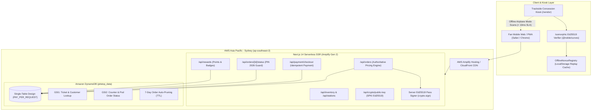

# Pit Stop: Food & Merch Drop Ecosystem

**Order ahead. Pick up fast. Get back to the on-track action.**  
*Commissioned for the Australian Grand Prix Corporation (AGPC) Fan Experience Innovation Project.*

[](https://nextjs.org/)
[](https://www.typescriptlang.org/)
[](https://tailwindcss.com/)
[](./frontend/src/__tests__)
[](https://maplibre.org/)
[](https://openfreemap.org/)
[](./frontend/src/lib/crypto)
[](https://aws.amazon.com/)

---

## Live Deployment & Access Credentials

| Service | Target URL | Credentials / Parameters | Description |
|---|---|---|---|
| **Fan Web Application** | [https://main.d3m92lj3xoqgf9.amplifyapp.com](https://main.d3m92lj3xoqgf9.amplifyapp.com) | Ticket: `GP-3820-X` | Mobile-optimized fan ordering & live digital pass portal |
| **Vendor Kiosk Terminal** | [https://main.d3m92lj3xoqgf9.amplifyapp.com/vendor](https://main.d3m92lj3xoqgf9.amplifyapp.com/vendor) | Staff PIN: `2026` | Trackside concession kiosk with camera scanner & offline verifier |
| **Public Key Endpoint** | [https://main.d3m92lj3xoqgf9.amplifyapp.com/api/crypto/public-key](https://main.d3m92lj3xoqgf9.amplifyapp.com/api/crypto/public-key) | None (Public / Cached) | Ed25519 public key in SPKI DER Base64 format |
| **Secondary Demo Ticket** | [https://main.d3m92lj3xoqgf9.amplifyapp.com](https://main.d3m92lj3xoqgf9.amplifyapp.com) | Ticket: `GP-9014-P` | Hui Wen Chew (Brabham Grandstand, Turn 4) |
| **Target AWS Region** | `ap-southeast-2` (Sydney) | Profile: `personal` | 100% Serverless scale-to-zero ($0.00 idle infrastructure cost) |

---

## Platform Architecture



---

## Executive Overview

**Pit Stop: Food & Merch Drop** is an enterprise fan-engagement and race-day logistics ecosystem architected for high-density public sports events. During peak Formula 1 race sessions at Albert Park, over 100,000 concurrent spectators place extreme load on trackside cellular towers and concession outlets, leading to severe network latency, dropped packets, and 45+ minute concession queues.

Pit Stop mitigates these operational bottlenecks through:

1. **Intelligent In-App Ordering & Scheduled Pickups:** Fans order meals and merchandise ahead, receiving precise collection windows synchronized with support races to bypass queues.
2. **Dynamic Geospatial Routing Across 4 Calibrated Concession Pods (M1-M4):** Powered by **Zero-Key MapLibre GL v5** and **OpenFreeMap vector tiles** with offline Dijkstra pedestrian routing around Albert Park Lake:
   * **Pod M1 (Main Straight / Pit Exit):** Calibrated at `(-37.8496, 144.9690)`, serving Fangio, Senna, and Prost Grandstands.
   * **Pod M2 (Turn 9 East / Clark):** Calibrated at `(-37.8442, 144.9746)`, serving Waite and Clark Grandstands.
   * **Pod M3 (Turn 4 / Lakeside Drive):** Calibrated at `(-37.8415, 144.9648)`, serving Brabham and Jones Grandstands.
   * **Pod M4 (Turn 14 / GA Village):** Calibrated at `(-37.8534, 144.9718)`, serving General Admission and Village Precinct.
3. **Dynamic Concession Yield Pricing Engine:** Modeled after EatClub's dynamic yield management, the platform dynamically triggers automated 10% off-peak green flag discounts and 15% promotional vouchers (`PITSTOP15`) during low-queue intervals to flatten crowd surges away from race finishes.
4. **Sub-10ms Offline Cryptographic Verification:** When mobile networks collapse trackside, customer order passes are validated offline via asymmetric Ed25519 digital signatures in under **10 ms** (typically **0.1 ms - 1.5 ms**) with zero cloud network requests.

---

## Pit Stop v2.1: Vector Map & Offline Wayfinding Engine

To overcome trackside cellular dropouts and complex topography around Albert Park Lake, Pit Stop v2.1 introduces a high-performance, completely offline-capable vector mapping and pedestrian wayfinding engine:

### 1. Zero-Key MapLibre GL v5 + OpenFreeMap Vector Maps
- **Zero API Key Dependency:** Replaces commercial cloud tile services with open vector tiles hosted by [OpenFreeMap](https://openfreemap.org), eliminating API key rate limits, usage quotas, and monthly billing surprises.
- **MapLibre GL v5 Architecture:** Powered by `maplibre-gl@^5.x` and `react-map-gl/maplibre` with custom Next.js 14 transpilation.
- **Multiple High-Contrast Styles:**
  * **Positron (Default Light):** High-readability daylight cartography optimized for direct outdoor sun trackside (`https://tiles.openfreemap.org/styles/positron`).
  * **Liberty (Street Details):** Detailed topographical streets and paths (`https://tiles.openfreemap.org/styles/liberty`).
  * **Dark (Night / Paddock):** Low-glare night race styling (`https://tiles.openfreemap.org/styles/dark`).
- **Resilient Offline SVG Fallback:** When WebGL or data networks are completely unavailable, the map automatically degrades to `OfflineCircuitMapFallback.tsx` with light/dark theme contrast adaptation, SVG track outline, calibrated pod pins, and route geometry.

### 2. Offline Dijkstra Pedestrian Routing Around Albert Park Lake
- **Lake Geometry Awareness:** Albert Park Lake is a major physical barrier spanning ~2 km. Naive straight-line or Euclidean routing misleads fans into attempting impossible walks across water.
- **16-Node Lakeside Walkway Graph:** Pit Stop builds an in-memory topological graph of official perimeter walking tracks, pedestrian boardwalks, and pedestrian bridges around Albert Park Lake.
- **Dijkstra Shortest-Path Algorithm:** Computes the optimal lake-skirting pedestrian path between the spectator's current position and any target concession pod (e.g. routing between M3 on Lakeside Drive and M2 on the Clark Chicane traverses the northern lake path via Ross Gregory Dr / Aughtie Dr rather than penetrating the lake).
- **Realistic Walk Time Modeling:** Calibrated walking velocity at 80 meters per minute (~4.8 km/h), dynamically calculating `walkMinutes = Math.max(1, Math.ceil(distanceMeters / 80))`.

### 3. Smart GPS Geofencing & Trackside Simulation Engine
- **Trackside Geofence (`2.5 km` Threshold):**
  * **`live_trackside` (Distance <= 2.5 km):** Activates live trackside mode with high-accuracy GPS positioning (`navigator.geolocation.watchPosition`), drawing an accuracy circle polygon and locking map interactions to Albert Park.
  * **`live_offsite` (Distance > 2.5 km):** Detects offsite fans (e.g. Melbourne CBD, interstate, or remote), displaying distance to circuit (e.g. `"You are 4.8 km from Albert Park"`) and providing seamless 1-tap switching to trackside simulation.
- **Interactive Trackside Simulation:**
  * **Grandstand Presets:** Instant teleportation to key vantage points: **Clark Grandstand (Turn 9)**, **Fangio Grandstand (Main Straight)**, **Brabham Grandstand (Turn 1)**, and **Albert Park Green (GA Village)**.
  * **Interactive Map Pin Placement:** Spectators can tap anywhere on the Albert Park map to place a simulated spectator dot.
  * **Step-by-Step Walk Simulation:** Simulates live pedestrian movement along the Dijkstra route waypoints to test wayfinding in real time.

### 4. Intelligent Total Time Station Ranking (`rankStationsByTotalTime`)
- Concession queue lines fluctuate rapidly during track sessions. Recommending solely based on physical proximity frequently directs spectators into congested bottlenecks.
- `rankStationsByTotalTime` combines real pedestrian route walk time with real-time station queue latency:
  $$\text{Total Time} = \text{Walk Minutes} + \text{Queue Wait Minutes}$$
- **Bottleneck Avoidance:** A pod 300 meters away with a 2-minute queue (total 6 mins) is automatically recommended over a pod 100 meters away with a 15-minute queue (total 16 mins), badging the optimal choice with **FASTEST TOTAL (WALK + QUEUE)**.

---

## Offline Cryptographic Protocol Specification

To operate in disconnected environments where 4G/5G connections drop, Pit Stop implements an asymmetric cryptographic validation protocol:

```
+-----------------------------------------------------------------------------------------+
|                                    QR Code Payload                                      |
|                                                                                         |
|   AGPC1 . <Base64URL(Canonical JSON Payload)> . <Base64URL(64-byte Ed25519 Signature)>  |
+-----------------------------------------------------------------------------------------+
```

### 1. Cryptographic Key Management
- **Algorithm:** Ed25519 (Edwards-curve Digital Signature Algorithm, RFC 8032).
- **Private Key:** Stored securely in AWS environment variables (`ED25519_PRIVATE_KEY_BASE64`) on the Next.js server. Never exposed to browser or client code.
- **Public Key:** Exposed via `GET /api/crypto/public-key` in standard SPKI DER format (`MCowBQYDK2VwAyEAXTZ23IPCQi9z2B0U4g6wNDVqanRuS3goJ9ULNdegGMY=`). Vendor terminals cache this key in `localStorage` upon shift initialization.

### 2. Deterministic Canonical Payload
Before signing, payload keys are deterministically sorted to prevent signature invalidation across JSON serializers:
```typescript
interface OrderPassPayload {
  orderId: string;          // e.g. "GP-2026-X9K2P4"
  customerId: string;       // e.g. "TICKET-GP-3820-X"
  targetStationId: string;  // e.g. "M2"
  issuedAt: number;         // Epoch timestamp (seconds)
  expiresAt: number;        // Epoch timestamp (seconds)
  items: OrderItem[];       // SKU, item name, quantity, unit price in cents
  nonce: string;            // 128-bit cryptographically secure random nonce
}
```

### 3. Verification SLA & Offline Execution
- Powered by pure JavaScript `@noble/curves/ed25519` with zero Node.js dependencies, bundling cleanly into browser and PWA service workers.
- **Single Verification Latency:** Typical **0.1 ms - 1.5 ms** on modern mobile hardware (SLA target: `< 10.0 ms`).
- **Tamper Detection:** Modifying order items, quantities, or pickup stations invalidates the Ed25519 signature mathematically.
- **Expiration Defense:** Passes are rejected automatically once `expiresAt` is exceeded.

### 4. Anti-Replay Defense (`OfflineNonceRegistry`)
To prevent ticket duplication or double-redemption attacks in complete airplane mode:
1. Vendor terminals maintain a local SQLite / `localStorage` index of redeemed cryptographic nonces.
2. When a QR code is scanned, `OfflineNonceRegistry.registerNonce(nonce, expiresAt)` evaluates the token.
3. First scan succeeds with `{ success: true, valid: true }`.
4. Subsequent scans of the identical QR code immediately fail with `{ success: false, valid: false, reason: "REPLAY_DETECTED" }`.
5. Nonces past their `expiresAt` timestamp are automatically pruned to prevent unbounded storage growth.

---

## Test Suite & Verification Results

Pit Stop includes full automated test coverage across cryptographic signing, authoritative pricing rules, serverless API contracts, and an end-to-end smoke verification runner.

```
✓ src/__tests__/geo.test.ts      (24 tests)     7ms
✓ src/__tests__/crypto.test.ts   (11 tests)   106ms
✓ src/__tests__/pricing.test.ts  (10 tests)     6ms
✓ src/__tests__/api.test.ts      (9 tests)    611ms

Test Files  4 passed (4)
     Tests  54 passed (54)
  Duration  815ms
```

### Suite Breakdown

1. **`geo.test.ts` (24 Tests):**
   - Haversine distance calculations benchmarked against known Albert Park landmark surveys (Pit Straight to Turn 1 Apex ~790m, Lake length North to South shore ~1473m, Albert Park Center to Melbourne Town Hall / CBD ~3490m, Albert Park to Sydney Opera House ~716.4 km within 2% tolerance).
   - High-accuracy GPS geofence classification (`2.5 km` threshold): Albert Park trackside points (`true`), Melbourne CBD and North Melbourne (`false`), Sydney Opera House (`false`).
   - 16-node undirected walkway graph wrapping the Albert Park Lake perimeter.
   - Dijkstra pedestrian route navigation: tests cross-lake navigation (M3 to M2, M4 to M3), asserting coordinates count >= 3, route distance > straight-line Haversine, and complete lake water intrusion avoidance.
   - GPS accuracy circle generator: produces valid GeoJSON `Feature<Polygon>` with closed coordinate rings (first point === last point).
   - Total time pod ranking (`rankStationsByTotalTime`): verifies that a station further away with a 2-min queue beats an immediate adjacent station with a 15-min heavy traffic queue, flagging `isRecommendedFastest: true`.
   - Grand Prix 5.278 km circuit GeoJSON line geometry, bounding boxes, and calibrated pod coordinates synchronization.

2. **`crypto.test.ts` (11 Tests):**
   - Ed25519 asymmetric keypair initialization & DER encoding.
   - Server-side cryptographic signing and QR payload generation (`AGPC1.*`).
   - Isomorphic client-side verification under `< 10ms` SLA target.
   - QR string parser and verification (`verifyQrPayload`).
   - Tampered payload detection (modified items, altered quantities).
   - Forged and corrupted signature rejection.
   - Expired pass rejection via epoch timestamps.
   - Concession pod station mismatch rejection.
   - 100-iteration continuous load benchmark (`avg: 0.89ms, peak: 1.7ms`).
   - `OfflineNonceRegistry` initial scan acceptance & replay duplicate rejection (`REPLAY_DETECTED`).
   - Nonce expiration window pruning.

3. **`pricing.test.ts` (10 Tests):**
   - Subtotal calculation against canonical catalog prices.
   - 10% dynamic yield Green Flag discount calculation.
   - Safety car bypass (0% dynamic discount during neutralizations).
   - 15% promotional voucher (`PITSTOP15`) overriding default discount.
   - Flat voucher discounts (`SAVE5`, `SAVE10`).
   - Free item vouchers (`FREE-BURGER`, `FREE-FRIES`).
   - Non-inversion discount guardrails (discounts cannot exceed subtotal).
   - 2.5% service fee IEEE 754 precision rounding.
   - Loyalty point calculation (2 points per $1 spent).
   - **Price-tampering resistance:** client-altered `unitPrice` fields in cart payloads are completely overridden by authoritative catalog prices.

4. **`api.test.ts` (9 Tests):**
   - `GET /api/crypto/public-key`: 200 OK with SPKI DER Base64 public key.
   - `POST /api/orders`: Generates `GP-2026-*` order ID, 4-digit pickup PIN, and signed Ed25519 pass.
   - `POST /api/orders`: 400 Bad Request on empty or invalid cart items.
   - `POST /api/payment/checkout`: Authorizes payment and returns identical cached response on duplicate idempotency keys.
   - `PATCH /api/orders/[id]/status`: Rejects unauthenticated requests without `X-Vendor-Pin` (401 Unauthorized).
   - `PATCH /api/orders/[id]/status`: Accepts valid PIN (`2026`), transitions status to `COMPLETED`, and auto-awards fan loyalty points.
   - `GET /api/rewards`: Returns ticket points, tier status, badges, vouchers, and transaction history.
   - `GET /api/inventory`: Returns real-time stock levels, pricing, and photo assets.
   - `GET /api/stations/capacity`: Returns queue status across pods M1-M4, supporting pod ID filtering and 404s.
   - `POST /api/auth/verify-ticket`: Validates Grand Prix ticket barcode codes (`GP-3820-X`).

### End-to-End Live Smoke Runner

Run the full end-to-end fan-to-vendor scenario:
```bash
cd frontend
npm run test:live
```

Output:
```
======================================================
🏎️  PIT STOP v2: END-TO-END SMOKE VERIFICATION SUITE
======================================================

⚡ Target mode: In-Process Next.js Serverless Route Dispatch (Standalone)
▶ STEP 1: Fetching Ed25519 Public Key from /api/crypto/public-key...
  ✓ Public Key fetched: AGPC-2027-KEY-01 (Ed25519)
  ✓ Public Key DER Base64: MCowBQYDK2VwAyEAXTZ23IPC...

▶ STEP 2: Creating Order via POST /api/orders...
  ✓ Order Created: GP-2026-9VY466
  ✓ Pickup Station: PIT STOP M2 (M2)
  ✓ 4-Digit PIN Code: 3428
  ✓ Subtotal: $69.00, Discount: -$10.35 (15% OFF (PITSTOP15 Promotional))
  ✓ Total Charged: $60.12 (Service Fee: $1.47)
  ✓ Points to Earn: +120 pts

▶ STEP 3: Validating Cryptographic Ed25519 Digital Pass Offline...
  ✓ Offline Signature Validated in 1.413 ms (Target < 10.0 ms SLA)
  ✓ Order ID decoded from QR: GP-2026-9VY466
  ✓ Initial barcode scan registered in OfflineNonceRegistry
  ✓ Replay attack detected: duplicate scan rejected with REPLAY_DETECTED

▶ STEP 4: Authorizing Payment via POST /api/payment/checkout...
  ✓ Payment Authorized: TxID TXN-GP-1795042838791-6657 (apple_pay)
  ✓ Payment idempotency verified: identical transaction returned for duplicate submission

▶ STEP 5: Updating Order Status to COMPLETED via PATCH /api/orders/[id]/status...
  ✓ Security check: unauthorized PIN rejected with 401
  ✓ Vendor marked order COMPLETED (Staff PIN: 2026 verified)

▶ STEP 6: Verifying Fan Rewards Balance & Badges via GET /api/rewards...
  ✓ Holder Name: Egor Zvyagin (GP-3820-X)
  ✓ Loyalty Balance: 1970 pts (Tier: Pit Lane Insider)
  ✓ Badges Count: 4 badges (3 unlocked)
  ✓ Active Vouchers: 5 vouchers

======================================================
🏁 ALL 6 SMOKE TESTS PASSED PERFECTLY IN 16 ms!
======================================================
```

---

## Local Development Setup

### 1. Prerequisites
- **Node.js:** `>= 20.0.0` (v20.x or v22.x LTS)
- **npm:** `>= 10.0.0`

### 2. Clone & Install
```bash
git clone https://github.com/egor-zvyagin/Pit-Stop-Food-And-Merch-Drop.git
cd Pit-Stop-Food-And-Merch-Drop/frontend
npm ci
```

### 3. Environment Variables
Copy the sample environment file:
```bash
cp .env.example .env.local
```

Key variables:
```bash
NEXT_PUBLIC_APP_URL="http://localhost:3000"
VENDOR_ACCESS_PIN="2026"
ED25519_KEY_ID="AGPC-2027-KEY-01"
DYNAMODB_TABLE_NAME="pitstop_data"
AWS_REGION="ap-southeast-2"
```

### 4. Seed Local Database & Data
```bash
npm run seed
```

### 5. Run Development Server
```bash
npm run dev
```
Open [http://localhost:3000](http://localhost:3000) for the Fan Web App or [http://localhost:3000/vendor](http://localhost:3000/vendor) (PIN: `2026`) for the Vendor Terminal.

### 6. Run Test Suites
```bash
# Run all Vitest unit and integration suites
npm test

# Run end-to-end smoke verification
npm run test:live

# Run linter
npm run lint

# Compile production build
npm run build
```

---

## Cloud Architecture & Cost Profile

The platform operates on a **100% Scale-to-Zero Serverless Architecture** in AWS Sydney (`ap-southeast-2`):

- **AWS Amplify Gen 2:** Global CloudFront edge distribution + serverless SSR compute.
- **Amazon DynamoDB Single-Table (`pitstop_data`):** On-demand billing (`PAY_PER_REQUEST`). Zero provisioned read/write capacity units (`RCU = 0, WCU = 0`). Under 25 GB AWS Free Tier limit, yielding **$0.00 idle cost**.
- **Automated Order Expiration (TTL):** Order records carry a 7-day TTL epoch attribute, automatically pruned by DynamoDB with zero consumed write capacity.
- **AWS Budget Protection:** Configured with an automated $5.00/month threshold alert.

For complete cloud deployment instructions, see [DEPLOYMENT_GUIDE.md](file:///Users/egorz/Desktop/new%20pit/DEPLOYMENT_GUIDE.md).

---

## Project Team & Governance

| Name | Role & Specialisation | GitHub Profile |
|---|---|---|
| **Egor Zvyagin** | Product Owner / Full-Stack & Cloud Engineer | [@egor-zvyagin](https://github.com/egor-zvyagin) |
| **Hui Wen Chew** | UX / UI Design Lead | [@huiwenchew](https://github.com/huiwenchew) |
| **Sahibjeet Singh** | Developer & Quality Assurance Engineer | [@Sahib-11](https://github.com/Sahib-11) |
| **Muhammad Rayyan Sohail** | Business Analyst & Requirements Engineer | [@S4073657](https://github.com/S4073657) |

---

## Industry Presentation & Recognition

Delivered as part of the Australian Grand Prix Corporation (AGPC) Industry Engagement Initiative. Exclusively invited to present live technical demonstrations to AGPC Executive Stakeholders at AGPC Corporate Headquarters (St Kilda Road, Melbourne), and selected for the **RMIT UNAUTOMATED Showcase**.
